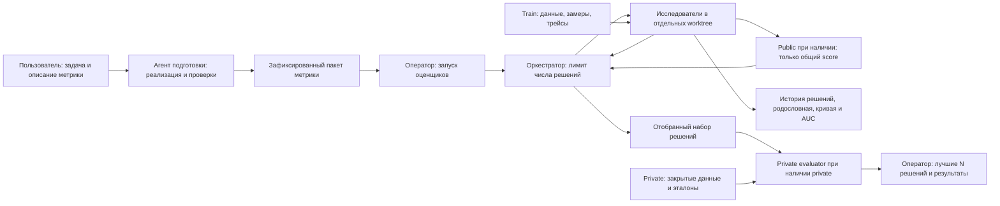

# Arena

Репозиторий для поиска и сравнения способов решения задач. Подготовка и поиск — отдельные запуски: сначала передай агенту [промпт подготовки](prompts/prepare.md), затем после её завершения отдельно запусти агента с [промптом поиска](prompts/start.md). Оркестрация описана инструкциями; отдельного агентного фреймворка здесь нет.

Кейс определяет задачу и метрику, промпт кампании — что разрешено менять. Решением может быть обычная программа, модельный подход или конфигурация стороннего харнеса. Харнес и его параметры могут быть фиксированы или участвовать в поиске. Способ оценки тоже может обходиться без LLM. Все модельные обращения с данными идут к внутренним моделям. Если решатель и судья используют LLM, у них одна зафиксированная модель.



## С чего начать

Каталог кампании задаётся явно при подготовке и передаётся поисковому агенту. Далее `<campaign_dir>` обозначает этот путь: например, `cases/<case>/campaigns/<campaign>` или `runs/<campaign>`.
1. Скопируй `cases/template` в `cases/<case_id>`. Опиши задачу и данные, а в `metric/` положи описание желаемой оценки: что считать правильным, какие ошибки различать, как свести результаты в общий балл. Можно добавить готовый код, тесты, критерии и примеры. Оценка может быть полностью программной, модельной или смешанной.
2. Передай агенту [промпт подготовки](prompts/prepare.md), путь к кейсу и условия кампании: разрешённые изменения, лимит предложенных решений, размер итогового набора, а для приватного финала — точное число финалистов K и итоговых решений N. Агент подготовит `metric.json`, необходимый код и проверки на открытых или синтетических примерах, конфигурацию запуска и `<campaign_dir>/campaign.md`. Подготовка метрики не учитывается в числе предложенных решений.
3. Агент проверяет и замораживает пакет метрики, записывает свидетельства готовности в `<campaign_dir>/preparation.md`. Оператор устанавливает зависимости, тот же пакет для всех split и запускает необходимые закрытые оценщики по [инструкции развёртывания](deploy/README.md). Исследователь получает только разрешённые URL и submit-токены. Полный порядок — в [подготовке](common/preparation.md).
4. После готовности передай [стартовый промпт](prompts/start.md). Агент исследует train: выбирает подвыборки, изучает трейсы, проверяет гипотезы. Public при наличии возвращает только общий score; private не возвращает агенту результаты. Любой раздел — train, public или private — может быть пустым; оценивание такого раздела пропускается. Сохраняются [замеры](common/mlflow.md), [родословная и история эволюции](common/search-history.md), включая неудачные решения.
5. Переход к финалистам разрешён только после исчерпания лимита или явной команды человека остановить поиск. При исчерпании лимита новые решения не предлагаются. По команде остановки новые проверки также прекращаются; выполняющиеся завершаются. Агент выбирает согласованный итоговый набор прошедших ревью решений по накопленным свидетельствам: качеству, разнообразию, устойчивости и риску переобучения. Для приватного финала это ровно K входных финалистов.
6. При непустом private весь замороженный набор отправляется на него один раз в рамках данной серии. Оценщик выбирает ровно N лучших по метрике и ресурсам, где N не больше K. Результаты доступны оператору; исследователь получает только статус. При пустом private кампания завершается сохранённым выбором по условиям кампании и доступным свидетельствам, без закрытого ранжирования и выдуманных private-оценок. Автоматического внедрения результатов нет.

Числа предложенных решений, финалистов и итоговых решений — разные настройки. Вход и выход private не ограничены пятью кандидатами. Оркестратор заранее планирует воронку, чтобы получить точное число финалистов, и не заполняет её дубликатами. Пользователь может назначить отдельную private-серию на тех же данных с сохранением прежней истории. Новое имя кампании само по себе такого решения не заменяет; порядок описан в [изоляции](common/isolation.md).

## Что где лежит

| Путь | Назначение |
| --- | --- |
| `common/` | Протокол, координация, история поиска, изоляция и логирование |
| `prompts/` | Подготовка арены, запуск поиска, роли исследователей и подготовка эталона при необходимости |
| `cases/<case>/metric/` | Описание оценки, `metric.json`, код, материалы и проверки метрики |
| `cases/<case>/campaigns/<campaign>/` или другой `<campaign_dir>/` | Условия и готовность кампании, замороженный пакет метрики, история поиска |
| `cases/<case>/dataset/` | Разрешённые train-данные и описание split; закрытые данные хранятся у оценщика |
| `cases/<case>/ways/` | Способы решения и замороженные пакеты кандидатов |
| `cases/<case>/prompts/` | Уточнения методологии и разрешённые изменения |
| `cases/<case>/` → `harness/`, `deploy/`, `acceptance/`, `tests/`, `proposals/` | Специальный харнес, развёртывание, приёмка, проверки и исходные идеи кейса |
| `cases/<case>/results/` | Результаты проверок решений |
| [archive/](archive/README.md) | Исторические отчёты разработки, свидетельства кейсов и локальные материалы; не входят в стартовый контекст |
| `evaluator/` | Оценивание, ранжирование, журнал поиска, клиент и закрытый сервис |
| `runner/` | Пример runner и исполнение через [общий протокол](common/runner-contract.md) |
| `deploy/` | Общая настройка контейнеров доверенным оператором |
| `integrations/` | Необязательные инфраструктурные адаптеры, например Docker-монитор исследователя |

Специальный для одного кейса код, профиль модели, серверные настройки и сценарии приёмки хранятся вместе с кейсом; исторические отчёты и свидетельства — в архиве. Общие механизмы оценивания, учёта ресурсов, инструментальных вызовов, публикации материалов и измеряемой подготовки остаются в ядре. Подключение дополнительных возможностей runner и трекинга явно задаёт оператор; обычная программная задача не требует базы знаний, конкретного харнеса или MLflow.

## Как считается оценка

Способ вычисления и направление (`maximize` или `minimize`) фиксирует пакет метрики кейса. `kind: command` запускает собственную программу: тесты, сравнение с эталоном, модельное судейство, их сочетание или другой алгоритм. Число судей, критерии, порядок проверок и агрегацию задаёт эта программа. Для модельных обращений команда объявляет `uses_model: true` и использует выданный внутренний gateway; арена отдельно учитывает её расходы. Обращения к LLM не обязательны ни для решения, ни для оценки.

Готовый профиль `kind: llm` с синтетическим эталоном остаётся удобным частным случаем: `votes` независимых оценок 1–5 каждого критерия, среднее голосов, взвешенное среднее критериев и среднее по примерам. `votes` — положительное целое, по умолчанию 3. Эталон и шкала этого профиля не ограничивают собственные метрики. На пример сохраняется один корректно полученный ответ решателя; валидный ответ ради балла не повторяется. Правила метрики и повторов фиксируются до поиска.

При равном качестве предпочтительнее полный учёт токенов, затем меньшее суммарное число токенов решателя, затем меньшее время решения, включая подготовку и повторы. Между неполными замерами токенов сравнивается время. При полном равенстве действует стабильный порядок `candidate_id`. Немодельное решение имеет нулевой расход токенов; неизвестный расход нулём не считается. Затраты оценщика записываются отдельно и не влияют на выбор. Подробности — в [правилах оценки](common/public-evaluation.md).

## Отправка финалистов

Этот этап выполняется при непустом private. Оператор предварительно настраивает сервис по [инструкции](deploy/README.md). Исследователь получает URL и submit-токен, без операторских секретов. Ниже пример пакета из двух кандидатов; его размер должен совпадать с настройкой конкретной кампании.

```bash
uv sync --frozen
uv run python -m evaluator.client pack \
  --candidate way-a=cases/my-case/ways/way-a \
  --candidate way-b=cases/my-case/ways/way-b \
  --output finalists.json
uv run python -m evaluator.search --journal runs/my-campaign/search.sqlite3 finalize \
  --bundle finalists.json
uv run python -m evaluator.client submit \
  --url https://private-evaluator.example \
  --token-file /run/secrets/arena-submit --bundle finalists.json
uv run python -m evaluator.client status \
  --url https://private-evaluator.example --token-file /run/secrets/arena-submit
```

Адрес и путь журнала — примеры. Пакет содержит файлы кандидатов; сервис проверяет безопасные пути и настроенный предел размера HTTP-запроса. При непустом private поисковая кампания использует его сервис в режиме `campaign` с каноническим журналом и зафиксированным лимитом предложенных решений; перед стартом проверяют `search-readiness` по инструкции развёртывания. При пустом private этот сервис, его readiness и отправка не нужны. Private проверяет финализацию, снимки и основание завершения поиска. До допуска предварительный выбор можно исправить командой `finalize --replace` из уже зарегистрированных снимков. Необратимое принятие принадлежит сервису после всех проверок допуска: затем идентичная повторная доставка возвращает существующее состояние, другой список в этой серии отклоняется. Submit/status не возвращают private-оценки или победителей. Оператор читает итог внутри закрытого контура.

## Граница закрытых данных

Контейнер защищает границу только при ограниченных правах исследователя. Если чат имеет доступ к закрытым каталогам, Docker daemon или операторскому SSH на той же машине, скрыть от него данные контейнерами нельзя.

Для чата с широким локальным доступом используй оценщик под отдельной кластерной учёткой. Во время проверки кандидат получает только текущий вход и разрешённые материалы; при необходимости модели — доступ к внутреннему gateway. Public скрывает данные, ответы, трейсы и отдельные оценки; private скрывает также все итоговые результаты от эволюционного агента. Подробности — в [изоляции](common/isolation.md).

## Проверка разработки

```bash
uv run ruff check .
uv run pyright
uv run pytest
uv run python -m evaluator.smoke
```

`uv run pytest` проверяет общее ядро в `tests/`. Проверки конкретного кейса запускаются отдельно: `uv run pytest cases/<case>/tests`; дополнительные команды приёмки указывает README кейса. Перенос исходников или новые общие проверки не заменяют приёмку нового образа на целевом узле.

Тесты и smoke используют вымышленные входы и подставные ответы. Они не запускают исследовательскую кампанию, не читают реальные датасеты и не обращаются к моделям или MLflow. Для нового харнеса нужен операторский образ с [единым протоколом запуска](common/runner-contract.md).
