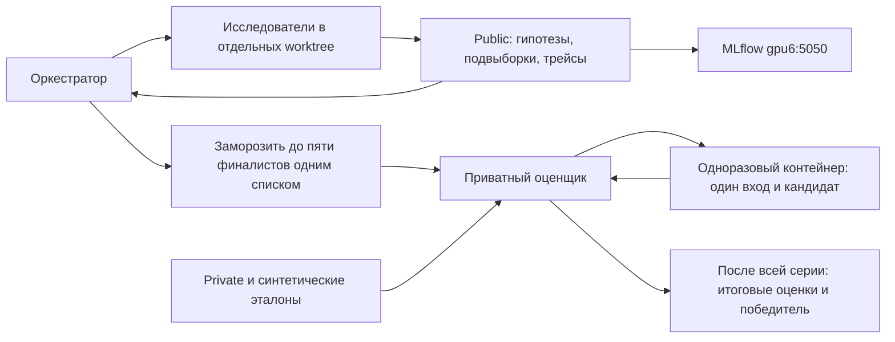

# Arena

Репозиторий для поиска и сравнения способов решения задач. Открой его в чате,
Codex, Hermes или другом агенте и передай [стартовый промпт](prompts/start.md).
Оркестрация описана инструкциями; отдельного агентного фреймворка здесь нет.

Модель и харнес решателя фиксируются на кампанию. Исследователи меняют только
разрешённые кейсом компоненты решения. Public доступен для экспериментов,
private служит однократной проверкой замороженных финалистов. Все обращения
с данными, включая подготовку эталонов, идут только к внутренним моделям.
Решатель и судья используют одну и ту же зафиксированную модель.



## С чего начать

1. Прочитай [правила исследования](common/research-protocol.md),
   [оркестрацию](common/orchestration.md) и [IMMUNE](common/IMMUNE.md).
2. Скопируй `cases/template` в `cases/<case_id>`. Опиши задачу, разрешённые
   изменения, критерии и данные. Реальные private-данные никогда не кладутся
   в этот репозиторий, его Git-историю или образы.
3. Зафиксируй условия в `runs/<campaign>/campaign.md`: версии public/private,
   критериев и эталонов, модель, харнес, параметры, доступные ресурсы и правило
   выбора. Оркестратор распределит направления между исследователями.
4. Исследуй public. Можно использовать подвыборки; фиксируй их состав.
   Перед отбором сравни финалистов на одинаковом публичном наборе.
   Используй [общую функцию судейства](common/public-evaluation.md) и сохраняй
   [трейсы и результаты в MLflow](common/mlflow.md).
5. Заморозь финалистов, отправь один пакет приватному оценщику. Не меняй
   решения по результатам private. Победитель становится артефактом для
   последующего переноса в продукт; автоматического деплоя нет.

Количество финалистов по умолчанию — пять. Если допустимых решений меньше,
оператор заранее задаёт меньшее число. Новый ID кампании не открывает новые
попытки на том же закрытом наборе.

## Что где лежит

| Путь | Назначение |
| --- | --- |
| `common/` | Общие правила, IMMUNE, координация, изоляция, MLflow |
| `prompts/` | Готовые задания оркестратору, исследователю, ревьюеру и подготовка эталона |
| `cases/<case>/metric/` | Версия метрики и критерии |
| `cases/<case>/dataset/` | Только public и его описание |
| `cases/<case>/ways/` | Способы решения и замороженные пакеты кандидатов |
| `cases/<case>/prompts/` | Уточнения общей методологии для кейса |
| `cases/<case>/results/`, `artifacts/` | Результаты и артефакты кейса |
| `evaluator/` | Общая формула оценки, клиент и приватный сервис |
| `runner/` | Простой пример фиксированного харнеса для изолированного запуска |
| `deploy/` | Настройка контейнеров доверенным оператором |
| `adr/` | Принятые решения новой арены |

## Как считается оценка

Используется `synthetic-reference-per-criterion-v1`: вариант №3 из Judge of
Judge, изменённый по договорённости 11.10.2026. Синтетический эталон готовят
и фиксируют заранее. Его генерация не входит в оценивание.

На пример решатель отвечает **один раз**. Судья оценивает этот же ответ
**три раза по каждому критерию отдельными независимыми запросами**.
Для K критериев это 3K запросов. Судья видит инструкцию кейса, один критерий, эталон
и ответ; не видит вход решателя с исходниками, предыдущие оценки и другие ответы для A/B.

Балл критерия — среднее трёх целых оценок 1–5. Балл примера — взвешенное
среднее критериев; веса нормируются на их сумму. Итог — среднее по примерам.
Пустой окончательный ответ получает 0. Инфраструктурная ошибка останавливает
проверку и не превращается в ноль модели. Private всегда оценивается целиком;
до завершения всех финалистов наружу возвращается только статус.
При равных лучших оценках `winner` равен `null`: численного основания выбрать
единственного победителя нет. Не запрашивай новые private-прогоны для разрешения ничьей.

## Отправка финалистов

Оператор предварительно настраивает сервис по [инструкции](deploy/README.md).
Исследователь получает только URL и submit-токен, без операторских секретов.

```bash
uv sync --frozen
uv run python -m evaluator.client pack \
  --candidate way-a=cases/my-case/ways/way-a \
  --candidate way-b=cases/my-case/ways/way-b \
  --candidate way-c=cases/my-case/ways/way-c \
  --candidate way-d=cases/my-case/ways/way-d \
  --candidate way-e=cases/my-case/ways/way-e \
  --output finalists.json
uv run python -m evaluator.client submit \
  --url https://private-evaluator.example \
  --token-file /run/secrets/arena-submit --bundle finalists.json
uv run python -m evaluator.client status \
  --url https://private-evaluator.example --token-file /run/secrets/arena-submit
```

Здесь адрес — пример, не запущенный сервис. Пакет содержит файлы кандидатов;
сервис проверяет пути, размеры и вычисляет hashes. Идентичная повторная
доставка возвращает существующее состояние, другой список отклоняется.

## От кого скрыт private

Контейнер защищает границу только при ограниченных правах исследователя.
Если чат имеет доступ к private-каталогам, Docker daemon или операторскому SSH
на той же машине, скрыть от него данные этими контейнерами нельзя.

Для чата с широким локальным доступом используй оценщик на кластере под
отдельной учёткой. Исследователь видит только submit/status API.
Внутри приватного контура кандидат выполняется в отдельном контейнере и
получает текущий вход, разрешённые материалы и доступ к фиксированной
внутренней модели. Эталоны, весь private и журналы судьи остаются у оценщика.
Подробности и границы гарантии — в [изоляции](common/isolation.md).

## Проверка разработки

```bash
uv run ruff check .
uv run pyright
uv run pytest
uv run python -m evaluator.smoke
```

Тесты и smoke используют вымышленные входы и подставные модельные ответы.
Они не запускают исследовательскую кампанию, не читают реальные датасеты и
не обращаются к моделям или MLflow. Для нового харнеса нужен небольшой
операторский образ с [единым протоколом запуска](common/runner-contract.md).

Результаты и границы выполненных проверок записаны в
[отчёте проверки](common/verification.md).
