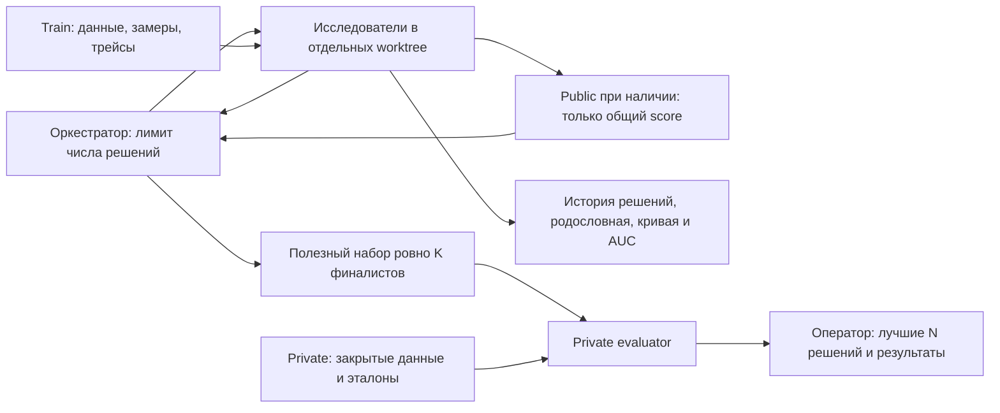

# Arena

Репозиторий для поиска и сравнения способов решения задач. Открой его в чате, Codex, Hermes или другом агенте и передай [стартовый промпт](prompts/start.md). Оркестрация описана инструкциями; отдельного агентного фреймворка здесь нет.

Кейс определяет задачу и метрику, промпт кампании — что разрешено менять. Решением может быть обычная программа, модельный подход или конфигурация стороннего харнеса. Харнес и его параметры могут быть фиксированы или участвовать в поиске. Способ оценки тоже может обходиться без LLM. Все модельные обращения с данными идут к внутренним моделям. Если решатель и судья используют LLM, у них одна зафиксированная модель.



## С чего начать

1. Прочитай [протокол исследования](common/research-protocol.md), [оркестрацию](common/orchestration.md), [ожидание долгих прогонов](common/long-runs.md) и [IMMUNE](common/IMMUNE.md).
2. Скопируй `cases/template` в `cases/<case_id>`. Опиши задачу, метрику, направление её улучшения и данные. Train доступен агенту полностью, public отдаёт только общий score, private не отдаёт агенту результаты. Train и public могут быть пустыми; для приватного финала нужен непустой private. Закрытые данные не кладутся в Git или образы.
3. Зафиксируй в `runs/<campaign>/campaign.md` версии данных и метрики, фиксированные условия, разрешённые промптом изменения, предел числа предложенных решений и точные размеры входа и выхода private. Число итоговых решений не превышает числа поданных финалистов. Лимита поиска по токенам нет.
4. Исследуй train: выбирай подвыборки, изучай трейсы, проверяй гипотезы. Агент сам выбирает способ валидации на train и фиксирует его. Если public непуст, используй его только через закрытую проверку с ответом в виде общего score. Измеряй токены и время, сохраняй [результаты](common/mlflow.md), [родословную и историю эволюции](common/search-history.md). Неудачные решения учитываются и могут породить новые.
5. Не предлагай решения сверх лимита. При явной команде человека остановить поиск прекрати новые проверки и дождись только уже запущенных. Выбери ровно заданное число финалистов по имеющимся свидетельствам: учитывай качество, разнообразие подходов, устойчивость и риск переобучения. Все проверки для отбора проводи в ходе поиска.
6. Заморозь и отправь весь набор на private один раз. Оценщик сам выберет заданное число лучших решений по метрике и ресурсам. Результаты доступны оператору; эволюционный агент получает только статус. Автоматического внедрения результатов нет.

Числа предложенных решений, финалистов и итоговых решений — разные настройки. Вход и выход private не ограничены пятью кандидатами. Оркестратор заранее планирует воронку, чтобы получить точное число финалистов, и не заполняет её дубликатами. Новое имя кампании не открывает попытку на прежнем private.

## Что где лежит

| Путь | Назначение |
| --- | --- |
| `common/` | Протокол, координация, история поиска, изоляция и логирование |
| `prompts/` | Задания оркестратору, исследователю, ревьюеру и подготовка эталона для модельной метрики |
| `cases/<case>/metric/` | Описание и версия метрики, направление улучшения, способ вычисления |
| `cases/<case>/dataset/` | Разрешённые train-данные и описание split; закрытые данные хранятся у оценщика |
| `cases/<case>/ways/` | Способы решения и замороженные пакеты кандидатов |
| `cases/<case>/prompts/` | Уточнения методологии и разрешённые изменения |
| `cases/<case>/results/`, `artifacts/` | Результаты и исторические артефакты |
| `evaluator/` | Оценивание, ранжирование, журнал поиска, клиент и закрытый сервис |
| `runner/` | Пример runner и исполнение через [общий протокол](common/runner-contract.md) |
| `deploy/` | Настройка контейнеров доверенным оператором |

## Как считается оценка

Способ вычисления и направление (`maximize` или `minimize`) фиксирует метрика кейса. Комплектный оценщик поддерживает модельного судью (`kind: llm`) и вычисляемую метрику (`kind: command`). Арена не требует LLM для получения ответа или оценки.

Профиль `synthetic-reference-per-criterion-v1` использует заранее подготовленный синтетический эталон. На пример сохраняется один корректно полученный ответ решателя. Судья оценивает этот ответ три раза по каждому критерию независимыми запросами; техническая ошибка запроса допускает до пяти повторов с тем же входом и настройками. Валидный ответ ради балла не повторяется. Балл критерия — среднее трёх оценок 1–5, балл примера — взвешенное среднее критериев, итог — среднее по примерам. Эти правила относятся к данному профилю. Для иной метрики можно задать собственную вычисляемую оценку и агрегацию по набору.

При равном качестве предпочтительнее полный учёт токенов, затем меньшее суммарное число токенов решателя, затем меньшее время решения, включая подготовку и повторы. Между неполными замерами токенов сравнивается время. При полном равенстве действует стабильный порядок `candidate_id`. Немодельное решение имеет нулевой расход токенов; неизвестный расход нулём не считается. Затраты оценщика записываются отдельно и не влияют на выбор. Подробности — в [правилах оценки](common/public-evaluation.md).

## Отправка финалистов

Оператор предварительно настраивает сервис по [инструкции](deploy/README.md). Исследователь получает URL и submit-токен, без операторских секретов. Ниже пример пакета из двух кандидатов; его размер должен совпадать с настройкой конкретной кампании.

```bash
uv sync --frozen
uv run python -m evaluator.client pack \
  --candidate way-a=cases/my-case/ways/way-a \
  --candidate way-b=cases/my-case/ways/way-b \
  --output finalists.json
uv run python -m evaluator.client submit \
  --url https://private-evaluator.example \
  --token-file /run/secrets/arena-submit --bundle finalists.json
uv run python -m evaluator.client status \
  --url https://private-evaluator.example --token-file /run/secrets/arena-submit
```

Адрес — пример, не запущенный сервис. Пакет содержит файлы кандидатов; сервис проверяет пути, размеры и hashes. Идентичная повторная доставка возвращает существующее состояние, другой список отклоняется. Submit/status не возвращают private-оценки или победителей. Оператор читает итог внутри закрытого контура.

## Граница закрытых данных

Контейнер защищает границу только при ограниченных правах исследователя. Если чат имеет доступ к закрытым каталогам, Docker daemon или операторскому SSH на той же машине, скрыть от него данные контейнерами нельзя.

Для чата с широким локальным доступом используй оценщик под отдельной кластерной учёткой. Во время проверки кандидат получает только текущий вход и разрешённые материалы; при необходимости модели — доступ к внутреннему gateway. Public скрывает данные, ответы, трейсы и отдельные оценки; private скрывает также все итоговые результаты от эволюционного агента. Подробности — в [изоляции](common/isolation.md).

## Проверка разработки

```bash
uv run ruff check .
uv run pyright
uv run pytest
uv run python -m evaluator.smoke
```

Тесты и smoke используют вымышленные входы и подставные ответы. Они не запускают исследовательскую кампанию, не читают реальные датасеты и не обращаются к моделям или MLflow. Для нового харнеса нужен операторский образ с [единым протоколом запуска](common/runner-contract.md).

Результаты и границы выполненных проверок записаны в [отчёте проверки](common/verification.md).
