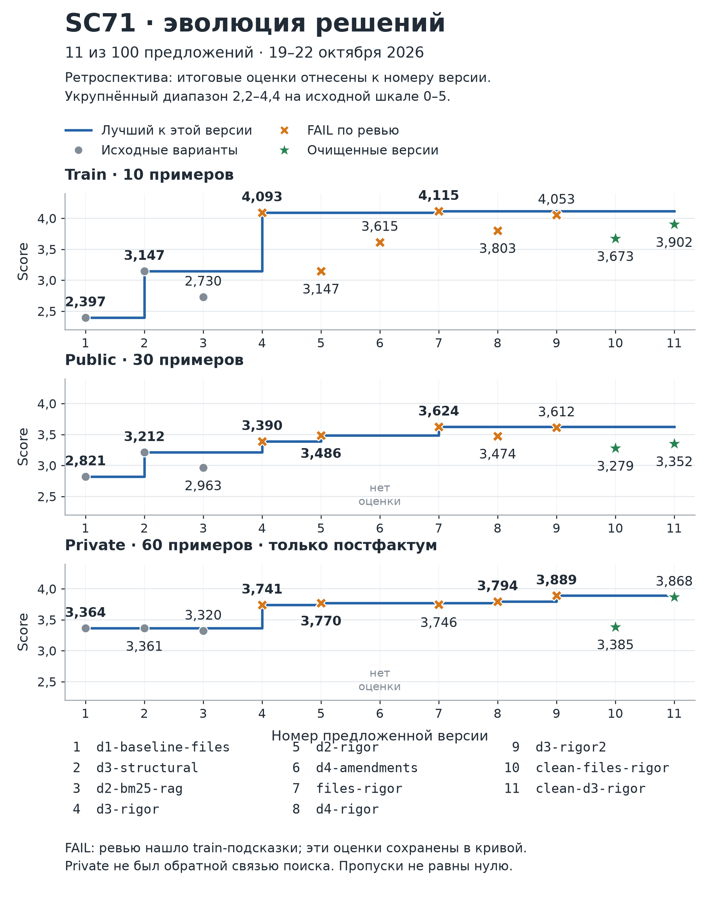
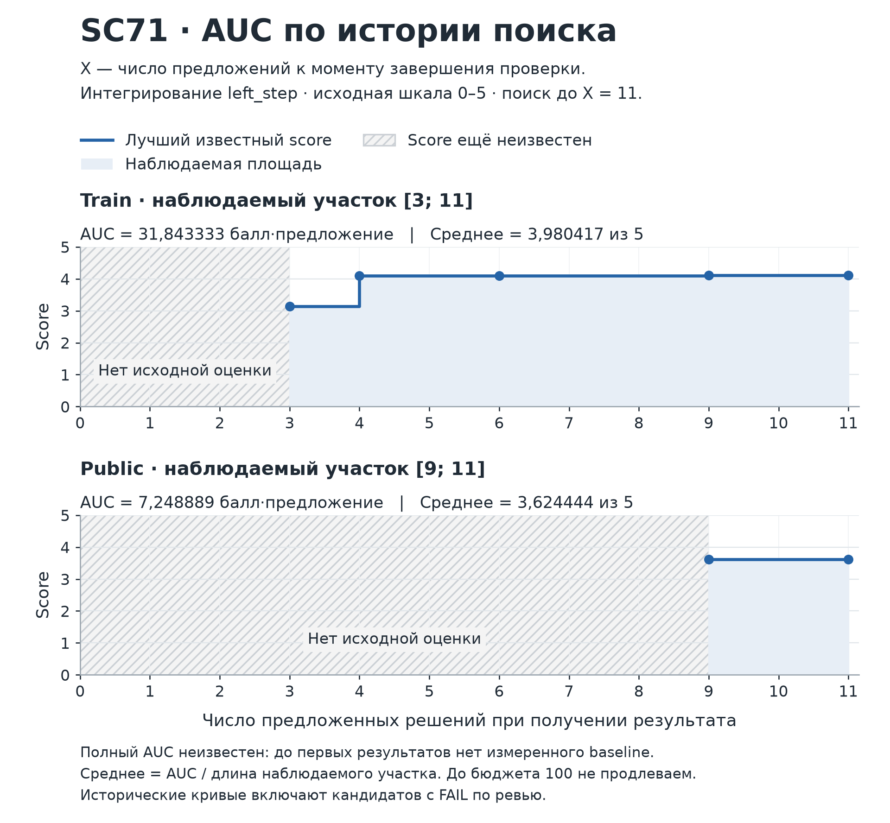

# SC 71 Результаты первого прогона

Кампания `sc71-first-20261019`. Отчёт от 23 октября 2026 года с дополнением об учёте токенов от 24 октября 2026 года.

## 1 Выбор приватного оценщика

Приватный оценщик завершил проверку десяти финалистов на 60 задачах и выбрал три итоговых решения: d3-rigor2, clean-d3-rigor и d4-rigor. Первое место получил d3-rigor2 с 3,888611 балла из 5. При этом d3-rigor2 и d4-rigor имели FAIL по ревью из-за конкретных фраз train-эталонов в промптах. Исторический результат private сохраняется, но его нельзя читать как подтверждение соблюдения условий кампании. [S1, S3]

| **Место** | **Решение**    | **Private** | **Ревью**          |
|-----------|----------------|-------------|--------------------|
| 1         | d3-rigor2      | 3,888611    | FAIL               |
| 2         | clean-d3-rigor | 3,867778    | PASS после очистки |
| 3         | d4-rigor       | 3,794167    | FAIL               |

Лучший результат среди вариантов, отмеченных PASS в документах кампании, — clean-d3-rigor. Он уступил формальному лидеру всего 0,020833 балла и израсходовал на private на 25,74% меньше учтённых токенов решателя. Это наиболее убедительный очищенный результат данного прогона. В сохранённых материалах не найдено независимого повторного ревью очищенных промптов; статус PASS взят из документов кампании. [S1, S3]

Лидер public, files-rigor, стал пятым на private с 3,745556. Поэтому ответ на вопрос «кто победил» зависит от смысла: официальный победитель — d3-rigor2; лучший очищенный кандидат — clean-d3-rigor. Разрыв между ними мал, и устойчивость этого порядка не измерена.

### Что проверяли

Кампания sc71-first-20261019 сравнивала способы поиска по базе нормативных документов и инструкции по подготовке ответа. Решатель и судья использовали одну модель DeepSeek-V4-Flash-0731 с effort=max; Hermes был фиксирован. Исследовались файловый поиск, BM25 по фрагментам, BM25 по целым пунктам и реестр изменяющих актов. [S2, S3]

Train содержал 10 задач, public — 30, private — 60, с равным представлением пяти тем. Балл 0–5 объединял полноту (35%), точность (35%) и обоснованность (30%). Решатель давал один корректно полученный ответ на задачу; судья использовал три голоса по критериям. Эти голоса не являются тремя независимыми запусками решателя. [S3]

## 2 Все проверенные решения

В журнале зарегистрированы 11 из 100 допустимых предложений. Все 11 прошли train, десять — public и private. Незавершённых или ошибочных записей измерений в итоговом журнале нет. Единственный вариант без public и private — d4-amendments. [S2]

| Ранг private | № | Решение | Train | Public | Private | Ревью |
| --- | --- | --- | --- | --- | --- | --- |
| 1 | 9 | d3-rigor2 | 4,053 | 3,612 | 3,889 | FAIL |
| 2 | 11 | clean-d3-rigor | 3,902 | 3,352 | 3,868 | PASS* |
| 3 | 8 | d4-rigor | 3,803 | 3,474 | 3,794 | FAIL |
| 4 | 5 | d2-rigor | 3,147 | 3,486 | 3,770 | FAIL |
| 5 | 7 | files-rigor | 4,115 | 3,624 | 3,746 | FAIL |
| 6 | 4 | d3-rigor | 4,093 | 3,390 | 3,741 | FAIL |
| 7 | 10 | clean-files-rigor | 3,673 | 3,279 | 3,385 | PASS* |
| 8 | 1 | d1-baseline-files | 2,397 | 2,821 | 3,364 | PASS |
| 9 | 2 | d3-structural | 3,147 | 3,212 | 3,361 | PASS |
| 10 | 3 | d2-bm25-rag | 2,730 | 2,963 | 3,320 | WARN |
| — | 6 | d4-amendments | 3,615 | — | — | FAIL |

Баллы округлены до трёх знаков. Ранги определены по исходным значениям. № — порядок регистрации предложения.

Ревью: PASS — допущен по записи кампании; WARN — замечание к примеру номера в комментарии к коду, без установленной передачи эталонного ответа модели; FAIL — обнаружены конкретные подсказки из train. Звёздочка у PASS означает очищенную версию и статус из итогового selection. Из шести FAIL-вариантов пять вошли в private; d4-amendments исключили из-за отсутствия public и покрытия его механизма кандидатом d4-rigor. [S3]

Переход от public к private изменил верхнюю часть рейтинга: clean-d3-rigor поднялся с шестого места на второе; d4-rigor — с четвёртого на третье; files-rigor опустился с первого на пятое. Это ранжирование разных наборов задач; рост или падение абсолютного балла нельзя трактовать как улучшение или ухудшение самого решения.

## 3 Как появились кандидаты

Родословная в журнале фиксирует родителей снимков. Общие правила rigor переносились между направлениями, хотя отдельные межветочные связи в parents не записаны. Сравнение неизменяемых снимков подтверждает, где менялся только prompt.md; digest всех десяти снимков совпали между train, public и private. [S2, S4]

### Файловая ветка

**d1-baseline-files → files-rigor → clean-files-rigor**

Первый вариант искал по каталогу заголовков и читал полные документы, без отдельного индекса. В files-rigor изменили только промпт: потребовали более строгие цитаты, проверку редакций, обоснование шагов, отказ при отсутствии ответа и соблюдение формата. В clean-files-rigor убрали конкретные train-фразы и заменили их общими правилами. Результат private вырос от 3,364 у baseline до 3,385 у очищенного потомка; неочищенный files-rigor получил 3,746.

### Ветка фрагментного поиска

**d2-bm25-rag → d2-rigor**

Исходный BM25 искал по фрагментам примерно по 2000 символов с перекрытием, после чего агент дочитывал полные документы. d2-rigor перенёс правила rigor в промпт при неизменном коде и параметрах поиска. Private вырос с 3,320 до 3,770, но новый промпт получил FAIL из-за train-подсказок.

### Ветка структурного поиска

- d3-structural → d3-rigor → d3-rigor2
- d3-rigor → clean-d3-rigor
- d3-structural → d4-amendments → d4-rigor

d3-structural индексировал целые нормативные пункты вместе с заголовками и соседним контекстом. d3-rigor сохранил код и параметры поиска, добавив rigor в промпт. d3-rigor2 усилил поиск для каждого шага многошагового ответа, ограничения на число цитат и требования к дословности. clean-d3-rigor записан потомком d3-rigor; он удалил train-подсказки и одновременно изменил общие инструкции о шагах и цитатах. Поэтому сравнение с родителем не является чистой абляцией удаления фраз.

d4-amendments добавил к структурному поиску реестр связей между базовыми и изменяющими или отменяющими актами. d4-rigor сохранил этот механизм и усилил промпт, включая обязательный поиск изменений. В private он занял третье место. Сопоставление с d3 не изолирует пользу реестра, поскольку различаются и инструкции.

## 4 Стоимость приватной проверки

Токены в миллионах, время в минутах. Суммы длительностей операций не равны длительности кампании по часам. Расходы решателя и оценщика учитываются отдельно. [S1]

| Решение | Решатель млн токенов | Решатель мин | Оценщик млн токенов | Оценщик мин |
| --- | --- | --- | --- | --- |
| d3-rigor2 | 20,186 | 76,8 | 3,266 | 106,0 |
| clean-d3-rigor | 14,990 | 69,9 | 3,132 | 116,0 |
| d4-rigor | 14,480* | 176,1 | 3,207 | 223,7 |
| d2-rigor | 13,474 | 54,1 | 3,114 | 96,3 |
| files-rigor | 23,699 | 93,0 | 3,212* | 184,9 |
| d3-rigor | 16,980 | 80,9 | 3,172 | 138,8 |
| clean-files-rigor | 20,215 | 74,9 | 3,063 | 125,6 |
| d1-baseline-files | 20,967 | 56,0 | 2,968 | 112,7 |
| d3-structural | 12,596 | 55,5 | 3,101 | 115,6 |
| d2-bm25-rag | 11,910 | 53,6 | 3,165 | 146,6 |

\* Неполный учёт токенов двух попыток. См. пояснение ниже.

clean-d3-rigor потребовал 14,990 млн токенов решателя против 20,186 млн у d3-rigor2. Экономия составила 5,196 млн токенов, или 25,74%; сумма длительностей решателя была меньше на 8,95%. При разнице 0,020833 балла это существенный практический аргумент в пользу очищенного варианта, хотя он не доказывает равенство качества.

files-rigor потребовал больше всего учтённых токенов решателя — 23,699 млн, при пятом месте на private. Отсутствие собственного индекса не означало малого модельного расхода. d4-rigor дал третий балл, но наибольшую сумму длительностей решателя — 176,1 минуты.

У d4-rigor отсутствуют сведения о токенах двух попыток решателя; его 14,480 млн — неполная сумма. У files-rigor не учтены токены двух попыток оценщика. Поэтому точные сравнения соответствующих расходов ограничены. [S1]

На 600 private-ответов зарегистрировано 169,499 млн токенов решателя и 31,399 млн токенов оценщика. Суммы неполны из-за четырёх попыток без учёта токенов. [S1] По train известно 39,762 млн токенов решателей и 5,905 млн токенов оценщиков. Расходы public в исследовательском журнале не заполнены; оценки ресурсов на создание кандидатов также неполны. Складывать эти данные в точную полную стоимость кампании нельзя. [S2]

## 5 Где различались результаты

Агрегаты private по пяти темам, по 12 задач в каждой. Названия тем даны как краткие функциональные описания. Тематические средние служат диагностикой; официальное место определено общим баллом. [S1, S3]

| **Тема**                       | **d3-rigor2** | **clean-d3-rigor** | **d4-rigor** | **files-rigor** |
|--------------------------------|---------------|--------------------|--------------|-----------------|
| T1 Редакция нормы              | 3,858         | 3,818              | 3,753        | 3,637           |
| T2 Отказ при отсутствии ответа | 4,081         | 4,268              | 4,232        | 4,567           |
| T3 Многошаговый ответ          | 3,014         | 3,451              | 3,250        | 2,869           |
| T4 Коллизии норм               | 4,076         | 3,606              | 3,881        | 3,968           |
| T5 Поиск нормы или документа   | 4,414         | 4,196              | 3,856        | 3,686           |

У clean-d3-rigor выше балл по теме многошаговых ответов, чем у d3-rigor2: 3,451 против 3,014. Формальный лидер сильнее по теме коллизий: 4,076 против 3,606, и по поиску целевого документа: 4,414 против 4,196. Близкий общий результат складывается из разных сильных и слабых сторон.

У 28 из 60 ответов d3-rigor2 и 29 из 60 ответов clean-d3-rigor автоматическая проверка не нашла хотя бы одну цитату длиной от 20 символов как дословный фрагмент указанных в ответе документов. Проверка игнорирует регистр и пробелы, но чувствительна к пунктуации и пропускам. Это проблема точности цитирования или указания источника; флаг сам по себе не доказывает фактический вымысел. [S1]

### Что подтверждается измерениями

Среди трёх исходных вариантов d3-structural оказался выше файлового и фрагментного поиска на train и public. В private базовый файловый вариант и структурный поиск почти совпали: 3,364 и 3,361. Обобщать преимущество структуры на любые настройки и наборы задач нельзя.

Очищенный структурный вариант оказался значительно выше исходного d3-structural на private: 3,868 против 3,361. Это поддерживает дальнейшее исследование общих правил поиска и ответа. Однако в одном сравнении изменилось несколько инструкций, поэтому вклад каждого правила не установлен.

В private clean-d3-rigor превзошёл своего записанного родителя d3-rigor на 0,127 балла, хотя на public уступил на 0,038. Нельзя объяснять наблюдаемые изменения только удалением train-фраз: вместе с ними менялись общие инструкции, а оценки получены на разных наборах задач.

### Рекомендация

Сохранить clean-d3-rigor как основной очищенный результат этого прогона. Его дальнейшее применение требует отдельной проверки корректности цитат и устойчивости качества. d3-rigor2 остаётся историческим победителем private, но FAIL по ревью исключает трактовку его победы как корректного выполнения всех условий кампании.

## 6 Ход прогона и границы выводов

Все даты и время приведены по Москве. Исследователь стартовал 19 октября в 23:02. Первые три направления зарегистрировали около 23:09–23:14. С 00:33 до 02:56 20 октября появились rigor-ветки и реестр изменений. После ревью в 09:38–09:39 зарегистрировали две очищенные версии. В 20:36 отправили десять кандидатов на private. Исследователь завершился 22 октября в 08:42, приблизительно через 57 часов 40 минут от старта. Private-сервис подтвердил complete. [S1–S3]

Поиск остановился при 11/100 без записанной команды человека. Осталось 89 неиспользованных предложений. Это неполный поиск; полученный рейтинг не доказывает исчерпанности направлений или достижения потолка качества. Однократная private-попытка уже использована.

Пять private-финалистов получили FAIL по train-подсказкам, включая первого и третьего победителей. Очищенные варианты позволяют извлечь полезный результат, но не отменяют нарушения в исторической процедуре отбора. Статус очистки принят из документов кампании; в сохранённых материалах не найдено независимого повторного ревью очищенных промптов.

В итоговом журнале на каждого кандидата приходится по одному завершённому замеру каждого доступного split; технические повторы не являются отдельными решениями. Train мал, public использовался для отбора, а по private не рассчитана устойчивость рангов. Разницу лидеров в сотые доли балла следует считать наблюдаемым порядком данного прогона, а не доказанным превосходством метода.

Проблема экспорта исследовательского трейса в MLflow относится к наблюдаемости прогона. Сохранившиеся серверные измерения и итог private complete позволяют восстановить результат. Сам сбой экспорта не объясняет качество кандидатов и не отменяет их баллы.

### Источники

Имена файлов и серверные пути ниже описывают источники исторического разбора.

[S1] Завершённая private-проверка на GPU6. Официальные score и winners из record.json; тематические агрегаты из `details/<candidate-id>.json`. Корень: /cephfs/home/malyshev_sa/arena-sc71-first-20261019/operator/state/private/. Определение проверки цитат: operator/metric/score.py в том же корне кампании; версия файла совпала с private provenance. Извлечения: private-summary.json и private-aggregates.json.

[S2] Итоговый журнал GPU6: /data/docker/volumes/sc71-campaign-runtime/_data/search.sqlite3. Источник предложений, parents, времён регистрации и train/public. Извлечения: genealogy.json и genealogy-summary.json. history.json устарел и для итоговых чисел не использовался.

[S3] Материалы в том же серверном томе: selection.md, final-report.md, state.md, board/findings/reviewer-wave4.md и findings кандидатов. Источник гипотез, ревью и отбора. Извлечения: source-review/method-sources.json и method-review.txt.

[S4] Неизменяемые ZIP-снимки candidates.snapshot в search.sqlite3 и сравнение их файлов. Источник различий промптов и неизменности кода и параметров поиска. Совпадение digest десяти снимков между train, public и private проверено в digest-crosscheck.json. Извлечение: prompt-snapshot-comparison.json.

Дата фиксации отчёта 23 октября 2026 года. Приватные вопросы, ответы и эталоны в отчёт не включены.

## 7 Эволюция кандидатов

Точки показывают итоговый балл каждого предложения; ступени — лучший результат среди уже перечисленных кандидатов. Это ретроспектива: private-баллы стали известны после поиска и не направляли его. [S1, S2]

У предложения № 6 нет public- и private-оценок. Пропуск не равен нулю. Кривые сохраняют исторические результаты, включая кандидатов с FAIL по ревью.

## 8 AUC поиска

Здесь X — число предложений на момент завершения замера. Балл входит в кривую только после появления обратной связи. Площадь считается по левым ступеням на наблюдаемом участке. [S2, S5]

| Split | Наблюдаемый интервал X | Площадь балл × предложение | Среднее под кривой от 0 до 5 |
| --- | --- | --- | --- |
| train | 3–11 | 31,843333 | 3,980417 |
| public | 9–11 | 7,248889 | 3,624444 |

Площадь = сумма (ширина интервала × лучший известный балл). Среднее под кривой = площадь / длина наблюдаемого участка: 8 для train и 2 для public. Это нормирование по горизонтальной оси сохраняет шкалу 0–5.

Полный AUC недоступен: начальный балл не задан, а участки 0–3 для train и 0–9 для public неизвестны. Неиспользованные 89 предложений не экстраполированы. Для private AUC обратной связи не рассчитывается. В train и public включены исторические FAIL-варианты; величины относятся к разным данным и участкам.

[S5] Зафиксированный серверный протокол common/search-history.md; расчёты по search.sqlite3. В исходном разборе локальные извлечения evolution-numeric-dataset.json и независимая сверка evolution-independent-auc.json совпали.

## 9 Расход токенов всего запуска

Дополнение от 24 октября 2026 года к отчёту первого прогона.

По сохранённым счётчикам запуск из 11 предложенных решений потребовал **не менее 469 169 336 токенов**. Учтены внешний оркестратор и его исследовательские субагенты, решатели и судья на train, public и private. Период запуска: 19.10.2026 23:02:39 - 22.10.2026 08:42:52 МСК.

| Роль | Входные | Выходные | Всего |
| --- | --- | --- | --- |
| Арена и исследователи | 115 702 766 | 917 030 | 116 619 796 |
| Решатели | 290 605 095 | 9 098 981 | 299 704 076 |
| Судья | 30 891 570 | 21 953 894 | 52 845 464 |
| Итого | 437 199 431 | 31 969 905 | 469 169 336 |

### Расход решателей и судьи по разделам

| Раздел | Решатели | Судья | Сумма |
| --- | --- | --- | --- |
| Train | 39 761 554 | 5 904 591 | 45 666 145 |
| Public | 90 443 900 | 15 542 249 | 105 986 149 |
| Private | 169 498 622 | 31 398 624 | 200 897 246 |
| Итого | 299 704 076 | 52 845 464 | 352 549 540 |

**Уточнение к разделу 4.** Расход public отсутствует в исследовательском журнале, но восстановлен из операторских счётчиков. В таблицы включён также отдельный расход внешнего агента. Прежнее замечание о невозможности точной полной суммы сохраняет силу только в части попыток без usage.

### Полнота учёта и границы суммы

Зарегистрирована 17 101 модельная попытка: 1 073 у арены, 7 093 у решателей и 8 935 у судьи. У 12 попыток нет сведений о токенах: 8 у арены и по 2 у решателя и судьи на private. Их расход неизвестен и не объявлен нулевым, поэтому итог является нижней границей.

Счётчики сверены по уникальным run_id: 1 010 запусков решателя, 1 010 запусков судьи и 8 сборок. Повторное чтение кеша и повторный экспорт в MLflow не прибавлены. Сборки не использовали LLM. Четыре технических запуска до начала кампании на 61 921 токен исключены. Затраты создания кандидатов не прибавлены повторно к расходу внешнего агента.

### Источники и способ записи

GPU6, каталог arena-sc71-first-20261019: operator/usage/*.json; resources из train/evaluations, public и private; manifest внешнего запуска 8d4c58eb-4a93-465a-a239-50a139a52613 в operator/state/research-monitor/records. Учёт хранится раздельно в orchestrator_tokens, solver_tokens и judge_tokens. Суммы означают входные плюс выходные токены, а не денежную стоимость.

## 10 Попытки без сведений о токенах

У всех 12 попыток сохранены статус ERROR и usage: null. Старый gateway записал только общий текст Model unavailable, без HTTP-статуса, класса исключения и идентификатора запроса upstream. Поэтому расход этих попыток и точная первопричина не восстанавливаются из сохранённых файлов арены.

| Роль | Число | Длительность ошибки | Последующее выполнение |
| --- | --- | --- | --- |
| Арена | 8 | 5-12 секунд | Три цепочки: 3, 3 и 2 ошибки; затем успех на попытках 4, 4 и 3 |
| Решатель private | 2 | 1 200,09-1 200,15 секунды | Успех на попытке 2 после паузы 30 секунд |
| Судья private | 2 | 1 200,09-1 200,15 секунды | Успех на попытке 2 после паузы 30 секунд |

### Что подтверждено

Ошибки внешнего агента составляют три последовательности технических повторов. Токены последующих успешных запросов уже входят в сумму 116 619 796; повторно добавлять их нельзя. Сохранённые ошибки не содержат счётчиков prompt_tokens и completion_tokens.

Четыре ошибки решателя и судьи закончились приблизительно через 20 минут. Это устойчивый временной признак, но сам по себе он не доказывает таймаут. Настройка MODEL_TIMEOUT арены составляла 21 600 секунд, то есть 6 часов; 20 минут с ней не совпадают. Для установления причины и восстановления расхода нужна операторская выгрузка журналов upstream. Автоматического доступа к ним нет; сохранённые трейсы арены необходимых сведений не содержат.

### Граница выводов

Все 12 запросов учитываются как попытки с неизвестным расходом. Они не заменяются нулём, приблизительной токенизацией или токенами успешного повтора. Поэтому **469 169 336 токенов** остаются подтверждённой нижней границей стоимости первого запуска. Повторный запуск моделей для восстановления расхода не проводился.

### Исправление учёта и диагностики

В локальном коде исправлен отдельный дефект: корректный ответ или вызов инструмента без usage либо с некорректным usage теперь возвращается один раз с usage: null, без повторной генерации. Неизвестный расход сохраняется как неизвестный. Добавлены категории usage_reason и error_reason, класс исключения, HTTP-статус и идентификаторы запросов. Исходящий X-Request-ID создаётся как UUID; upstream_request_id принимается только в формате UUID, чтобы не сохранять произвольный заголовок.

Исправление прошло локальные проверки Ruff, Pyright, тесты ядра и SC-71 и smoke. Эти проверки подтверждают поведение учёта и диагностики на воспроизводимых сценариях; они не восстанавливают токены 12 исторических ошибок и не доказывают устранение сбоя upstream.

24 октября исправление установлено на GPU6 в обоих gateway: model-gateway и researcher-gateway. Оба сервиса исправны; 11 изолированных smoke-проверок прошли. Модель, параметры, метрика, данные и исторические счётчики сохранены. Реальные модельные вызовы при установке не выполнялись. Расход 12 исторических попыток остаётся неизвестным.

Источник: операторские metadata и usage сохранённых 12 ошибочных попыток, их соседние технические повторы и конфигурация gateway первого запуска. Содержимое закрытых примеров и итоговые оценки для этого разбора не использовались.
