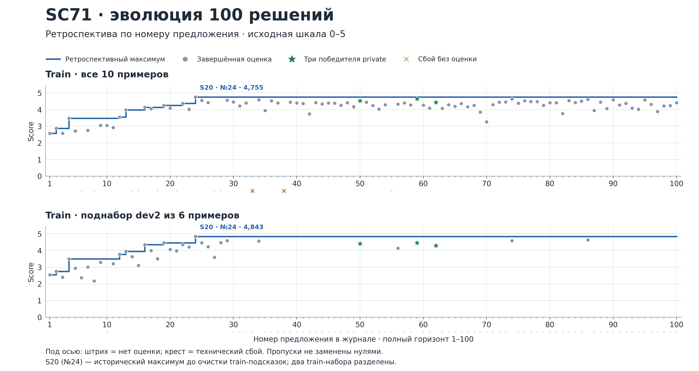
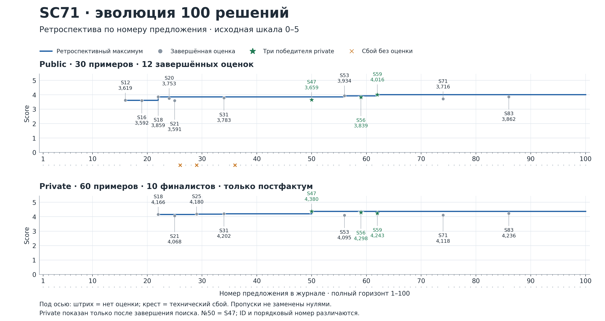
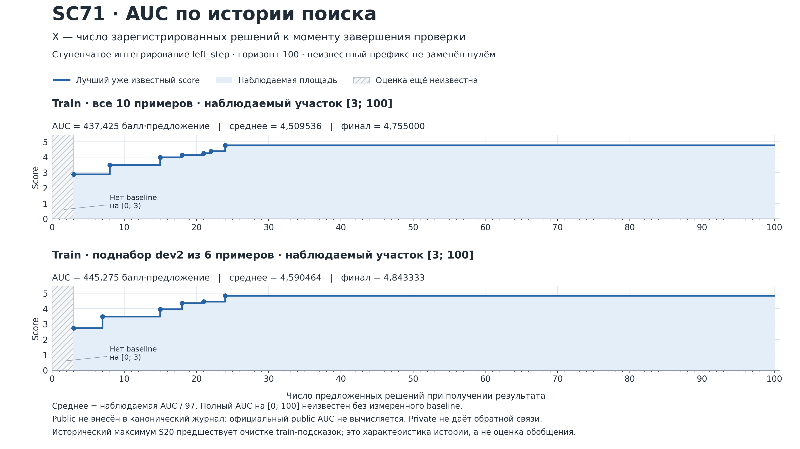

# SC 71 Результаты второго прогона

2 ноября 2026 года · Кампания sc71-second-20261024 · 100 предложенных решений

## 1 Выбор приватного оценщика

Private завершился 2 ноября в 09:30 МСК: десять финалистов проверены на 60 задачах каждый, сохранены все 600 результатов. Оценщик выбрал S47, S56 и S59. Первое место получил S47 с 4,379722 балла из 5. Это вариант, который просит агента прекращать бесплодное расширение поиска и переходить к чтению найденного материала и ответу. Два следующих места заняли варианты с более коротким описанием документа в поисковой выдаче. [S1, S3]

| Место | Решение | Private | Механизм |
| --- | --- | --- | --- |
| 1 | S47 | 4,379722 | Остановка повторяющегося поиска |
| 2 | S56 | 4,298056 | Короткий паспорт 420 символов |
| 3 | S59 | 4,243056 | Ещё короче паспорт 320 символов |

S47 опередил S56 на 0,081667 балла, а S56 опередил S59 на 0,055. Эти разницы описывают один прогон на данном наборе: независимые повторения решателя и доверительные интервалы ранга не получены. Лидер public S59 стал третьим на private; S47 поднялся с девятого места среди 12 завершённых public-проверок на первое. Разные наборы задач дают разный порядок и не означают, что один и тот же снимок изменился между проверками.

Тройка победителей относится к линии S21 → S31, где были удалены конкретные подсказки ранних вариантов. Допуск победителей зафиксирован в ревью оркестратора и итоговом отборе. Это не равнозначно независимой сертификации всей линии. В числе десяти финалистов есть S18, допущенный с явным риском переобучения из-за конкретных train-примеров в промпте; он занял седьмое место. [S3, S6]

### Что проверяли

Решения отвечают на вопросы по базе нормативных документов: находят нужный акт и редакцию, разбирают многошаговые процедуры и коллизии, цитируют основания либо отказывают при отсутствии ответа. Решатель и модельный судья использовали одну закреплённую модель DeepSeek-V4-Flash-0731 с effort=max. Агентский решатель работал в Hermes; судью вызывала программа метрики через gateway. Менялись разрешённые представления документов, инструменты поиска и проверки, инструкции агенту и параметры выдачи.

Train содержит 10 задач, public — 30, private — 60. В каждом полном разделе представлены пять тем. Балл 0–5 объединяет полноту (35%), точность (35%) и обоснованность (30%); итог — среднее по темам. На пример сохраняется один корректно полученный ответ решателя, по каждому критерию судья получает три корректных голоса. Голоса не являются тремя независимыми решениями задачи. Новая private-серия использовала прежние 60 контрольных примеров по команде пользователя. [S1, S2]

## 2 Все проверенные решения

Лимит использован полностью: в журнале 100 предложений с неизменяемыми снимками и 138 завершённых train-измерений, из них 126 успешных и 12 ошибочных. Хотя бы один успешный train-замер получили 97 кандидатов; полный train из десяти примеров — 89. На public отправлены 15 кандидатов: 12 получили общий балл, три проверки завершились ошибкой. Private проверил десять выбранных финалистов. Ошибка проверки и отсутствие проверки не равны нулевому качеству. [S1, S2]

В таблице ниже показан весь private-пакет. Train — полный набор из десяти задач; результаты малых train-срезов не подставляются вместо него. Все 100 предложений, их смысл и доступные баллы перечислены в приложении. Номер регистрации и короткий ID Sxx различаются: например, предложение №100 имеет ID S97. Короткий ID — имя версии, а не координата эволюции.

| Ранг | № | Кандидат | Train 10 | Public 30 | Private 60 | Допуск |
| --- | --- | --- | --- | --- | --- | --- |
| 1 | 50 | S47 · Остановка повторяющегося поиска | 4,523 | 3,659 | 4,380 | Ревью оркестратора |
| 2 | 59 | S56 · Короткий паспорт 420 символов | 4,642 | 3,839 | 4,298 | Ревью оркестратора |
| 3 | 62 | S59 · Ещё короче паспорт 320 символов | 4,432 | 4,016 | 4,243 | Ревью оркестратора |
| 4 | 86 | S83 · Меньше служебных полей в паспорте | 4,610 | 3,862 | 4,236 | Независимое ревью |
| 5 | 34 | S31 · Согласованная схема индекса | 4,580 | 3,783 | 4,202 | Ревью оркестратора |
| 6 | 29 | S25 · Двухэтапный поиск процедуры | 4,557 | — | 4,180 | Ревью оркестратора |
| 7 | 22 | S18 · Сборка сильных ранних правил | 4,373 | 3,859 | 4,166 | Допущен с риском |
| 8 | 74 | S71 · Без отдельной проверки редакций в промпте | 4,630 | 3,716 | 4,118 | Ревью оркестратора |
| 9 | 56 | S53 · Приложения только для командировок | 4,325 | 3,934 | 4,095 | Ревью оркестратора |
| 10 | 25 | S21 · Очистка от конкретных train-подсказок | 4,552 | 3,591 | 4,068 | Независимое ревью |

Баллы округлены до трёх знаков; ранги определены по исходным значениям. У S25 public завершился ошибкой и не дал балла. Его сохранили во входном private-пакете как отдельный процедурный подход. S20 имел лучший полный train (4,755), но не вошёл в private; подробное ревью допускало его с материальным риском переобучения. Нельзя переносить его train-максимум на закрытые задачи. [S2, S3, S6]

У S18 промпт заранее содержит конкретные выводы для train-примеров: приказ №4506-1, пункт 5.3, и цепочку распоряжений №423 → №631. Подробное ревью признало это допустимым обучением по действовавшим условиям, но отдельно отметило риск переобучения. В отчёте сохраняются и допуск, и риск; новая отметка FAIL задним числом не присваивается. Положительные отметки всех десяти кандидатов имеют различную глубину и авторство. [S3, S6]

## 3 Как появились кандидаты

### Что здесь считается кандидатом

Во всех вариантах использовались одна и та же модель и один харнес Hermes. Кандидат — это сохранённая версия инструкции модели, поискового кода, инструментов проверки и разрешённых настроек. Поэтому «100 эволюций» означает 100 зарегистрированных версий решений, включая неудачные и диагностические варианты. Это не сто независимо обученных моделей и не цепочка из ста последовательных улучшений: от сильной версии часто ответвлялись несколько альтернатив, а большинство не попадало в финал. Короткие имена заканчиваются на S97, но не совпадают с порядком регистрации: отдельный S27 отсутствует, а S06b, S06c, S06d и S06e занимают собственные места. Например, S47 — предложение №50, S56 — №59, S59 — №62, S83 — №86.

Главная линия прошла путь от ручного поиска по файлам к поиску по текстовым фрагментам и служебным карточкам документов, затем к проверке цитат и более аккуратной подаче контекста. Ниже объясняется именно устройство решений. Заявленные автором причины улучшений остаются гипотезами: один замер не позволяет доказать, что балл изменился только из-за предполагаемого механизма. Описания сверены с неизменяемыми снимками, а не только с названиями кандидатов.

### Один сквозной пример

Возьмём иллюстративный вопрос: «Как сотруднику оформить служебную командировку, какие документы подготовить до поездки и что представить после возвращения?» Для объяснения вообразим, что в базе есть полный регламент, его старая копия, отдельные файлы заявления и отчётной формы. Это синтетическая ситуация, а не закрытый вопрос или воспроизведение ответа модели. Она показывает различие подходов, но сама по себе не является результатом эксперимента.

**S01 — самостоятельный поиск по файлам.** Агент ищет слова о командировке через grep, открывает найденные Markdown-файлы и составляет ответ. Отдельного поискового индекса у него нет. Чтобы не потерять форму, агент должен сам заметить ссылку на приложение внутри регламента, найти соответствующий файл и прочитать его. Если он остановится на первом подходящем абзаце, ответ может содержать разрешение поездки, но пропустить документы после возвращения. Это возможный сценарий работы механизма, а не установленная ошибка каждого ответа S01.

**S03 — поиск сразу возвращает подходящие фрагменты.** Программа подготовки делит документы на абзацы, сохраняет ближайший номер пункта или заголовок и строит текстовый индекс SQLite FTS5. Инструмент arena_search находит фрагменты по словам запроса и ранжирует их по BM25 — мере текстового совпадения. Модель получает готовую подборку со ссылками и при необходимости дочитывает файлы. Для нашего вопроса модель получает сразу несколько найденных пунктов о поездке вместо того, чтобы открывать каждый файл по отдельности. Но найденный отрывок ещё не равен полному регламенту: разные этапы процедуры могут находиться далеко друг от друга или в отдельных приложениях.

**S07 и его потомки — поиск также по паспорту документа.** Паспорт здесь означает служебную карточку для поиска: название, реквизиты, номера приказов, даты, начало текста и перечень разделов. Она индексируется отдельно от нормативных абзацев. Длинный регламент можно найти по названию или номеру приказа, даже когда нужный абзац плохо совпал с запросом. Система сочетает оба сигнала и выдаёт до десяти основных документов, до двух фрагментов документа и дополнительные одноимённые редакции. Для нашего вопроса карточка помогает обнаружить сам регламент, а фрагменты — нужные нормы. S09 отдельно объясняет модели, что карточка не является нормой: из неё нельзя брать цитату, нужно открыть исходный файл. Индекс определяет, какие документы найдутся и в каком порядке; выдача определяет, какую часть найденного текста увидит модель.

### Как заставляли найденное превращаться в проверяемый ответ

Первые ответвления исправляли разные ошибки поведения, почти не меняя поиск. S02 и S04 уточняли отказ: если документ устанавливает право на выплату, но не содержит её размера, нельзя сочинять процент или сумму. S05 требовал искать изменения документа, в том числе приказ, добавленный в конец того же файла. S06 усиливал дословность цитат и соблюдение JSON. В нашем примере это три отдельных задачи: найти действующий регламент, не додумать неизвестную величину и точно передать найденные требования.

Затем появилась программная проверка цитирования. В S06b инструмент verify_quote получает одну цитату и идентификатор документа, читает файл и проверяет, встречается ли цитата в его тексте после нормализации пробелов и регистра. В S06e инструмент check_answer принимает весь черновик, извлекает длинные цитаты и проверяет их в процитированных файлах. Например, нельзя объединить два удалённых предложения регламента, изменить слова для удобства пересказа и выдать результат за непрерывную дословную цитату. В S20 добавлена проверка существования файлов по ссылкам.

Эти инструменты не доказывают правильность всего ответа. check_answer проверяет цитаты длиной от двадцати нормализованных символов и наличие документов; он не устанавливает полноту процедуры, применимость нормы или верность юридического вывода. Более того, это инструмент самого кандидата: он возвращает список проблем и ok=false, а требование исправить черновик задаёт промпт. Называть его независимым внешним запретом отправки некорректного ответа было бы неточно.

К S18–S20 эти механизмы собрали вместе: поиск по фрагментам и паспортам, отказ при отсутствии нормы, проверка редакций, пошаговый ответ, проверка цитат и ссылок. Однако ранняя сборка содержала конкретные train-подсказки: реквизиты актов, части ID документов и требуемые формулировки известных ответов. S21, предложение №25, изменил только prompt.md: удалил из S20 перечисленные примеры редакций, идентификаторы и процедурные подсказки, оставив общие действия — найти акт по реквизитам из нового вопроса, проверить изменения, прочитать норму, собрать шаги и подтвердить цитаты. Три победителя происходят от этой версии через S31. Это подтверждает удаление конкретных зашивок, а не отсутствие любых следов настройки на train: на его результатах строилась вся эволюция, а некоторые примеры отказа в поздних промптах сохранились.

В данном запуске важна отдельная оговорка: ранний S18 всё же вошёл в private-десятку. Его сохранённое ревью считает допустимым, но сам снимок содержит описанные конкретные учебные примеры. Следовательно, наличие записи о допуске не отменяет этого ограничения. S18 не вошёл в итоговую тройку; его результат сохраняется как историческое измерение и не служит подтверждением того, что весь отбор был свободен от подобных подсказок.

### Полный регламент и приложения решают разные задачи

После очистки исследовали, как различать несколько файлов одного акта. S24 добавил в карточку метку типа копии: полная, скан или извлечение. Тип определяется эвристически по структуре, объёму и исходному файлу, поэтому метка не доказывает юридической полноты. На нашем примере она помогает предпочесть регламент с основным текстом короткому извлечению. S30 попытался перенести этот механизм непосредственно на S21, но поисковый код уже ожидал новые поля ctype/cmeta, а подготовка индекса ещё не создавала их. S31 исправил именно схему индекса. Это инженерное исправление, а не новая идея поиска.

Дальше выясняли, как не потерять формы. Для читателя полезно различать три направления. **S39 поднимает форму выше в поиске:** если запрос содержит слова о форме, бланке или приложении, подходящим документам добавляется балл. **S40 сразу показывает содержимое формы:** распознаёт приложение, индексирует его целиком, возвращает до 4000 символов как цитируемый нормативный текст и может добавить связанные формы к выбранному регламенту. **S41 меняет объяснение для модели:** служебный паспорт нельзя цитировать, но это не запрещает открыть и процитировать сам файл формы. Индекс и ранжирование S31 при этом остаются прежними.

На сквозном примере разница проста. Первый способ делает заявление заметнее в списке результатов. Второй приносит его текст вместе с регламентом. Третий напоминает агенту прочитать уже найденное заявление. Эти подходы решают похожую задачу разными механизмами; их нельзя объединять под неясным словом «улучшенный поиск».

S43 проверил вариант без автоматического добавления связанных форм, сохранив их цитируемое представление. S53 включал особое представление и добавление приложений лишь для запросов с командировочными словами. Проверка в коде относится к текущему запросу arena_search, а не непосредственно к исходному вопросу пользователя: результат зависит и от того, как агент сформулировал поиск. S25 отдельно исследовал двухэтапную процедуру — сначала внутренний регламент, затем необходимые внешние источники отдельных шагов. S45 добавил финальную проверку покрытия частей вопроса: до поездки и после возвращения должны быть раскрыты отдельно, с соответствующими ссылками.

### Что именно изменили три победителя

**S47, предложение №50, — перестать искать одно и то же.** Он наследует S31 и добавляет один абзац в промпт. После трёх-четырёх разных запросов, если новые запросы уже не приносят новых релевантных документов, нужно перейти к чтению найденного материала и подготовке ответа. Не следует многократно повторять почти одинаковый запрос или перечитывать файл только ради уверенности. Это условная инструкция модели, а не принудительное ограничение четырьмя вызовами и не изменение технического reasoning_effort. В нашем примере поведение можно представить так: найден регламент → найдены заявление и отчётная форма → новые поисковые запросы повторяют те же документы → агент переходит к чтению и ответу. Это продолжение синтетической иллюстрации, а не измеренный трейс. У S47 самый высокий private-балл: 4,379722. Он оказался выше своего S31-родителя с 4,202222, хотя на полном train был немного ниже: 4,523333 против 4,580000. Это наблюдаемое различие на сохранённых наборах; оно не доказывает универсального преимущества короткого поиска.

**S56, предложение №59, — оставить больше места нормам.** Паспорт документа полезен для навигации, но длинная служебная карточка сама занимает контекст модели. S56 сохраняет индекс, формулу поиска и промпт S31, но в показанном паспорте убирает перечень СТРУКТУРА и сокращает оставшееся окно с 750 до 420 символов. Вместо длинного оглавления модель видит более короткую карточку, а основное внимание может уделить нормативным фрагментам и чтению файла. Такое объяснение было гипотезой автора, а подтверждённое изменение — именно форма выдачи. Private-балл S56 равен 4,298056, второе место.

**S59, предложение №62, — ещё более короткая карточка.** Это прямой потомок S56: окно уменьшается с 420 до 320 символов, остальная механика сохраняется. Он проверяет, сколько служебной информации действительно нужно для навигации. Уменьшение может убрать шум, но также скрыть реквизит, поэтому «короче всегда лучше» из эксперимента не следует. S59 был лидером public, а на private занял третье место с 4,243056, немного уступив S56. В отчёте это два близких варианта одного рецепта, а не два разных вида искусственного интеллекта.

В итоге тройка состоит из двух разных направлений изменения S31: ограничение повторяющегося поиска в S47 и сокращение показываемых карточек в S56/S59. Позднейший номер сам по себе не сделал решение лучше: победил вариант, появившийся на половине лимита предложений.

### Чем заняты остальные поздние версии

S56 стал удобной базой для небольших проверок. S57 оставлял паспорт до 2000 символов без структуры, S79 пробовал 560. S74 расширял основной список с десяти до двенадцати документов, S91 сужал до девяти. S82 и S86 разрешали три фрагмента одного документа вместо двух. S90 и S93 делали отбор второго фрагмента строже или мягче. Для вопроса о поездке дополнительный документ мог принести форму, а дополнительный фрагмент регламента — шаг после возвращения; одновременно мог добавиться нерелевантный текст. Изменения такого рода — настройки одного подхода, а не новые архитектуры.

S83, предложение №86, менял уже содержимое индексируемого паспорта: убирал повторяющиеся поля объёма и размера исходника, заменял длинный путь именем файла. В том же окне 420 символов освобождалось место для названия, дат и реквизитов. Схематично карточка вместо «тип копии; объём; длинный путь; размер; реквизиты» начиналась с «тип копии; имя файла; реквизиты». Это иллюстрация расположения полей, а не реальная карточка закрытого документа. Важное отличие от S56: S83 меняет текст индекса, поэтому может менять и ранжирование. Кроме того, отдельная метка типа копии по-прежнему содержит сведения об объёме; удалено их дублирование внутри ограниченного окна, а не все числа из контекста. На private S83 получил 4,235833 и занял четвёртое место.

Другие варианты помогали проверить, какие инструкции нужны. S71 удалял большой раздел о проверке редакций из промпта, но сохранял автоматическое добавление редакций поисковым кодом и общие требования ответа. S68, напротив, отключал именно это автоматическое добавление. S66 и S97 снимали обязательную проверку всего черновика через check_answer, но сохраняли инструменты и требование verify_quote для отдельных длинных цитат. Называть их «ответами совсем без проверки цитат» неверно. S96 возвращал сильную линию S83 к grep и чтению файлов, сохраняя проверяющие инструменты: так проверялась необходимость готового индексного поиска.

Не все сравнения оказались чистыми. Например, S81 заявлялся как изменение порядка фрагментов, но сортировал их по строковому локатору ещё до ограничения числа и отбора по баллу. Значит, менялся также состав выдачи; эффект нельзя приписать одному лишь порядку чтения. S35/S36, как и S30/S31, содержат обычное исправление интерфейса между индексом и поисковым кодом. Неудачи остаются частью ста предложений, но технический сбой сам по себе не опровергает исследовательскую идею.

### Как читать эту историю

Главный результат — не утверждение, что сотая версия лучше первой во всех отношениях. За сто предложений появились общий работающий рецепт, несколько его сильных вариантов, проверки отдельных компонентов и отрицательные результаты. Поиск по документам, точность цитат, выбор редакции, полнота процедуры и объём контекста оказались разными задачами, которые нельзя решить одним неопределённым требованием «отвечать лучше». Полный каталог с коротким объяснением каждой версии и её родителями вынесен в приложение; баллы и графики следует читать отдельно по сопоставимым наборам.

Описания механизмов при подготовке отчёта сверены с неизменяемыми `candidates.snapshot` в исходной копии журнала `source/search.sqlite3` и извлечёнными файлами `source/snapshots/<candidate_id>/{prompt.md,prepare.py,retrieve.py,check_answer.py,solution.json}`. Записанная родословная взята из `candidates.record.parents`; она не всегда перечисляет все заимствованные идеи. Причины включения финалистов взяты из исходного `source/campaign-memory/board/selection.md`, итоговые private-значения — из `source/private-summary.json`. Сквозной пример придуман только для объяснения устройства решений и не заменяет измерений.

## 4 Стоимость приватной проверки

Токены приведены в миллионах, суммы длительностей — в часах. Время решателя включает подготовку внутри примера и технические повторы; расходы судьи учитываются отдельно. Это суммы измеренных операций, а не продолжительность всей кампании по настенным часам. [S1, S4]

| Решение | Решатель млн токенов | Решатель ч | Судья млн токенов | Судья ч |
| --- | --- | --- | --- | --- |
| S47 | 27,813 | 2,39 | 2,992 | 2,83 |
| S56 | 34,344* | 2,72 | 3,066 | 2,80 |
| S59 | 36,145 | 2,63 | 3,041 | 2,96 |
| S83 | 26,489 | 2,38 | 3,050* | 3,55 |
| S31 | 30,161 | 2,49 | 3,066 | 3,41 |
| S25 | 33,659 | 2,10 | 3,003 | 2,17 |
| S18 | 27,960* | 2,16 | 2,958 | 2,27 |
| S71 | 24,100 | 2,25 | 3,015 | 2,87 |
| S53 | 28,388 | 2,14 | 3,050 | 2,67 |
| S21 | 28,013 | 2,58 | 2,969 | 3,35 |

Звёздочка означает неполный учёт токенов: у S56 неизвестен расход шести попыток решателя, у S18 — четырёх, у S83 — шести попыток судьи. Эти попытки сохранены и входят в измеренное время, но неизвестные токены не объявлены нулём.

Всего на private учтено 297,071297 млн токенов решателей и 30,209118 млн токенов судьи. Сумма длительностей — 23,85 часа решателей и 28,88 часа судьи. Итог токенов является нижней границей из-за 16 попыток без usage.

S47 получил на 0,1775 балла больше своего родителя S31 и использовал 27,813 млн токенов решателя против 30,161 млн, то есть на 7,8% меньше. Учёт токенов обоих полный. Это наблюдаемое сочетание качества и расхода в пользу S47; один прогон не изолирует причинный эффект инструкции о завершении поиска.

Сокращение паспорта документа не гарантировало меньшего суммарного расхода. S56 и S59 использовали 34,344 и 36,145 млн учтённых токенов решателя, больше S31; у S56 дополнительно неизвестны шесть попыток. Более короткий отдельный результат поиска может менять последующие запросы, чтение и длину диалога.

## 5 Где различались результаты

Тематические средние private рассчитаны по 12 задачам в каждой теме. Таблица показывает тройку победителей и S83, который был выбран первым во входном списке финалистов. Названия тем сокращены; официальный ранг определяется общим средним по пяти темам. [S1]

| Тема | S47 | S56 | S59 | S83 |
| --- | --- | --- | --- | --- |
| T1 Редакция нормы | 4,400 | 4,035 | 3,821 | 4,353 |
| T2 Отказ при отсутствии ответа | 4,822 | 4,843 | 4,882 | 4,864 |
| T3 Многошаговая процедура | 3,544 | 3,799 | 3,768 | 3,571 |
| T4 Коллизии норм | 4,281 | 4,343 | 4,111 | 4,086 |
| T5 Поиск нормы или документа | 4,851 | 4,471 | 4,633 | 4,306 |

S47 сильнее S56 в проверке редакций (4,400 против 4,035) и поиске нормы или документа (4,851 против 4,471). S56 лучше на многошаговых процедурах (3,799 против 3,544). Поэтому общий порядок скрывает разные сильные стороны. Многошаговые процедуры остаются наиболее трудной темой у всех трёх победителей.

Автоматическая проверка точности цитат выставила флаг fabricated_quote в 3 из 60 ответов S47, в 2 у S56 и ни в одном у S59. Этот флаг означает, что хотя бы одна проверяемая цитата не совпала дословно с указанным документом по правилам метрики; сам по себе он не доказывает вымысел содержания. Проверка редакций отметила t1_update_error в двух ответах S59 и ни в одном у S47 и S56. Нулевой счётчик конкретного автоматического флага не является доказательством полной юридической или фактической корректности.

### Что можно рекомендовать по этому прогону

Сохранить S47 как первый итоговый вариант, а S56 и S59 — как остальные два выбранных private-сервисом решения. S47 сочетает лучший общий балл с меньшим учтённым расходом, чем S56 и S59. При задачах, где особенно важна процедура, полезно учитывать тематический профиль S56. Перед практическим применением нужна отдельная проверка на новых вопросах и точности цитат; этот отчёт новых оценок не запускает.

## 6 Ход прогона и границы выводов

Все даты и время приведены по Москве. После исправления каталога слотов чистый поиск стартовал 25 октября в 23:59; первое предложение зарегистрировано 26 октября в 00:14. 26 октября исправлен маршрут модельного судьи и поиск продолжен с сохранением трёх кандидатов. Позже устранены ожидание ошибочного public-статуса и ограничения модельного шлюза, а интервалы повторов увеличены до суммарных 30 минут. [S2, S7]

30 октября в 13:41:05 журнал подтвердил 100 из 100 предложений и финализацию десяти кандидатов. Private остановился в 19:13:49 из-за недоступности судьи: сохранились 54 готовых измерения и ответ решателя на 55-й пример. Первоначальное развёртывание новых повторов затронуло только внешний путь и пропустило внутренние сервисы. 31 октября исправление проверили во всех модельных ролях и в 09:54:28 продолжили тот же private-пакет. Готовые ответы не пересчитывали; старые ошибки и затраты сохранили. [S1, S7]

Private завершил оценивание 2 ноября в 09:30:14; процесс восстановления закончил выгрузку в 09:39:05 с кодом 0. Новых предложений после финализации не создавалось. Полное использование бюджета исправляет недостаток первого прогона, остановившегося на 11 предложениях, но само число 100 не доказывает исчерпанности всех методов.

### Сопоставимость и пределы интерпретации

Train из десяти задач мал и многократно использовался для разработки. Срез dev2 содержит шесть из этих же десяти задач; название не означает два примера. На пересечениях сервис мог возвращать уже сохранённые ответы решателя из кеша. Поэтому полный train и dev2 нельзя трактовать как независимые повторения или усреднять с public как три равноправных независимых оценки. [S2, S6]

Private является повторно используемым контрольным набором: новая серия разрешена пользователем на тех же 60 примерах. Лучший общий балл вырос с 3,888611 в первом запуске до 4,379722 во втором, на 0,491111. У первого формального лидера было отрицательное ревью; лучший очищенный вариант первого запуска имел 3,867778. Сравнение показывает наблюдаемую разницу исторических результатов, но не измеряет отдельно эффект 100 предложений, исправлений инфраструктуры или конкретного алгоритма и не заменяет нового независимого набора.

В каждом методе одновременно участвуют поиск, представление документов, промпт и поведение модели. Даже когда в снимке изменена одна инструкция, одного измерения недостаточно для устойчивого причинного вывода. Термины из findings вроде «подтверждённая обобщаемость» и «активный ингредиент» в этом отчёте не принимаются как статистическое доказательство.

Допуск S18 с train-подсказками и различия глубины ревью сохраняются как ограничения процедуры. У тройки победителей выборочная сверка подтвердила удаление конкретных подсказок S18, но не проводился новый полный аудит каждого чтения данных и сетевого обращения. Все три варианта создавались с использованием train. [S6]

## 7 Эволюция кандидатов

Ось X — порядок регистрации всех 100 предложений. Точки показывают сохранённые оценки конкретных версий, ступени — лучший результат среди уже перечисленных номеров. Это ретроспектива, а не график доступной в тот момент обратной связи. Неудачные и непроверенные варианты остаются на оси; пропуски не превращаются в нули. Полный train и dev2 разведены по панелям. [S1, S2, S5]

### Public и private

Public показан только там, где получен общий балл. Private нанесён только для десяти финалистов после завершения поиска; оценки остальных 90 кандидатов не рассчитывались и не восстанавливаются интерполяцией.

## 8 AUC поиска

Здесь X — число предложений на момент завершения измерения. Результат входит в кривую только после появления обратной связи. Площадь считается по левым ступеням на известном участке; каждый train-набор и набор условий сохраняет собственную кривую. [S2, S5]

### Численный расчёт AUC

| Набор | Наблюдаемый X | Площадь балл × предложение | Среднее на участке |
| --- | --- | --- | --- |
| dev2 · 6 задач | 3–100 | 445,275000 | 4,590464 |
| Train 10 | 3–100 | 437,425000 | 4,509536 |

Площадь — сумма произведений ширины интервала на лучший уже известный балл. Среднее под кривой делит площадь на длину наблюдаемого участка, здесь 97 предложений. Оно остаётся на шкале 0–5 и не является вероятностью правильного ответа. Начальный участок 0–3 неизвестен: до поиска не был задан измеренный baseline. Полный AUC и среднее на всём горизонте 0–100 поэтому не подменяются нулевым началом.

Все 138 записей измерений в SQLite относятся к train. Public выполнялся вне этого журнала; его конечные баллы восстановлены из операторских записей, но канонических событий обратной связи для AUC нет. Времена изменения public-record были переписаны технической миграцией 31 октября и не являются временем получения балла исследователем. Public AUC не рассчитывается. Private AUC поиска не рассчитывается по смыслу: закрытые результаты не направляли поиск.

Кривые включают исторические версии с отмеченным риском переобучения, в том числе train-лидера S20. AUC измеряет лучший доступный балл в ходе этой процедуры, а не автоматически качество допустимого или обобщающегося решения. Полный train и dev2 имеют разный состав и получают отдельные AUC. В первом и втором запуске сам split сохранён, но горизонты поиска различаются: 11 и 100 предложений. Поэтому площади двух кампаний нельзя напрямую сравнивать как одинаковые измерения.

## 9 Расход токенов всего запуска

Кампания из 100 предложенных решений потребовала не менее **1 613 076 942 токенов**: 1 545 998 229 входных и 67 078 713 выходных. В сумму входят четыре запуска внешнего исследователя и его исследовательские обращения, решатели и судья на train, public и private, включая неудачные обращения и технические повторы. Это расход текущей канонической кампании с 25 октября 2026 года 23:59:44 до завершения private 2 ноября в 09:30:14 МСК. Денежная стоимость не рассчитывалась.

| Роль | Входные токены | Выходные токены | Всего |
| --- | ---: | ---: | ---: |
| Арена и исследователи | 491 107 251 | 2 483 716 | 493 590 967 |
| Решатели | 996 634 435 | 23 856 215 | 1 020 490 650 |
| Судья | 58 256 543 | 40 738 782 | 98 995 325 |
| Итого | 1 545 998 229 | 67 078 713 | 1 613 076 942 |

Решатель расходует токены, когда читает найденные материалы, вызывает инструменты и составляет ответ. Судья отдельно оценивает этот ответ по зафиксированной метрике. Внешняя арена предлагает и реализует кандидатов, анализирует train и организует проверки. Эти три вида работы имеют отдельные счётчики; они не складываются повторно через записи подготовки кандидатов.

| Раздел | Решатели | Судья | Сумма |
| --- | ---: | ---: | ---: |
| Train | 507 771 608 | 48 877 910 | 556 649 518 |
| Public | 215 647 745 | 19 908 297 | 235 556 042 |
| Private | 297 071 297 | 30 209 118 | 327 280 415 |
| Итого оценивание | 1 020 490 650 | 98 995 325 | 1 119 485 975 |

Общая сумма включает 138 train-измерений, 15 public-проверок и весь private-пакет из 600 проверок. Среди public есть 12 завершённых проверок и три неудачные; расходы неудачных проверок также учтены. Сохранённая отдельная сборка S52 завершилась неудачно за 8,44 секунды без модельных обращений. Подготовка контекста и работа инструментов внутри решателей уже включены в их измерения.

#### Как исключён двойной счёт

Первичный источник суммы — доверенные счётчики gateway по уникальным run_id. Проверены 3 879 внутренних scope и четыре внешних запуска исследователя; пересечений между группами нет. Количество попыток и суммы токенов независимо сверены с метаданными всех 39 664 сохранённых модельных обращений. Повторное чтение кеша, повторный экспорт в MLflow и восстановление private не добавляют уже учтённый расход второй раз.

В двух неудачных train-проверках ресурсов было недостаточно для прямой привязки: в resources решателя отсутствовал run_id. Для S30 восстановлена связь с 13 вызовами на 300 166 токенов, для S35 — с 11 вызовами на 313 893 токена. Совпали все счётчики и все пары времён начала и окончания модельных вызовов в записи проверки и gateway. Эти 614 059 токенов включены в строку train. Ни одна неудачная попытка не была удалена из стоимости из-за отсутствия итогового score.

Заявленные при регистрации кандидатов расходы подготовки не прибавлены к сумме gateway: это другой уровень учёта, который перекрывается с работой внешнего исследователя. Иначе один и тот же расход мог бы попасть в итог дважды. Восстановленный 55-й private-ответ решателя также учтён один раз; сохранены расходы прежних неудачных обращений судьи и новых успешных голосов.

#### Границы суммы

У 359 модельных попыток отсутствует usage, поэтому 1 613 076 942 — подтверждённая нижняя граница. Неизвестные токены не приравниваются к нулю и не восстанавливаются приблизительной токенизацией. Из суммы исключены пять внутренних приёмочных scope на 63 808 токенов и один внешний preflight на 125 токенов: вместе 29 обращений и 63 933 токена. Синтетические mock-счётчики не считаются реальным расходом модели.

Неудачный запуск до чистого старта 25 октября был удалён по команде пользователя вместе с его внешним usage и трейсами. Его расход в текущем архиве не восстанавливается. Также эта сумма не измеряет работу операторского чата и агентов сопровождения вне четырёх запусков исследователя. Поэтому её нельзя называть полной стоимостью всех подготовительных и ремонтных работ с 24 октября.

#### Время

От чистого старта до окончания private прошло **7 дней 9 часов 30 минут**. В этот срок входят поиск, ожидание модели, технические повторы, остановки и ручное восстановление. После восстановления private 31 октября в 09:54:28 МСК до его окончания прошло **1 день 23 часа 35 минут 46 секунд**.

| Величина | Часы | Что измерено |
| --- | ---: | --- |
| Календарный срок всей кампании | 177,51 | От чистого старта до завершения private |
| Сумма длительностей внешних исследовательских запусков | 100,21 | Работа четырёх контейнеров, включая ожидание |
| Сумма длительностей решателей | 81,98 | Все учтённые примеры и сборка, с подготовкой и повторами |
| Сумма длительностей судьи | 93,50 | Оценивание и повторы |
| Сумма длительностей модельных запросов всех ролей | 148,78 | Время от отправки до завершения каждой попытки |

Эти длительности нельзя складывать как последовательные этапы: часть процессов выполнялась параллельно, а время запросов входит во время решателей и исследователя. Они также не являются GPU-часами: отдельно время вычислений модели и время в очереди не измерялись.

## 10 Ошибки обращений и неизвестный расход

Зафиксированы **39 664 модельные попытки: 39 254 успешных и 410 ошибочных**. У 359 ошибок нет usage. Ещё 51 ошибочная попытка вернула счётчики токенов, и её расход уже входит в общую сумму. Поэтому число ошибок и число неизвестных расходов различаются.

| Роль и раздел | Все попытки | Ошибки | Без usage |
| --- | ---: | ---: | ---: |
| Арена и исследователи | 3 130 | 77 | 75 |
| Решатель train | 9 486 | 81 | 81 |
| Судья train | 8 319 | 75 | 51 |
| Решатель public | 4 094 | 74 | 74 |
| Судья public | 3 602 | 69 | 62 |
| Решатель private | 5 610 | 11 | 10 |
| Судья private | 5 423 | 23 | 6 |
| Итого | 39 664 | 410 | 359 |

Сохранённая диагностика объясняет все 410 ошибочных попыток: 254 ответа HTTP 503, 97 ответов HTTP 500, восемь ошибок подключения ConnectError, 22 ошибки валидации модельного ответа и 29 несоответствий требуемой JSON-схеме. Все 359 попыток без usage относятся к HTTP 500/503 или ошибке подключения. В 51 ответе, отклонённом валидацией или схемой, usage присутствует. HTTP 200 сам по себе не означает корректный ответ по контракту.

Ограничение gateway в 1 000 сообщений было отдельным отказом до отправки модели: такой HTTP 400 не является upstream-попыткой и не входит в эти 39 664 модельных обращения. Аналогично, зависший пользовательский waiter и недоступный сетевой адрес судьи — инфраструктурные состояния; их нельзя считать новыми ответами модели или нулевым качеством кандидатов.

#### Почему private удалось продолжить

30 октября в 19:13:49 МСК private остановился на судействе 55-го примера: предыдущие 54 проверки были завершены, ответ решателя на 55-й уже сохранён, а корректных голосов судьи для него ещё не было. Первичная причина — один HTTP 503 и пять HTTP 500. Исправление 31 октября продолжило тот же принятый пакет, сохранило его seal, кандидатов и готовые ответы. На восстановленном примере учитываются шесть прежних ошибок и девять новых успешных голосов, а не новая генерация ответа решателем.

Паузы между техническими повторами теперь равны 30, 90, 240, 540 и 900 секундам, суммарно 30 минут. Сами неудачные запросы занимают дополнительное время. Первое развёртывание обновило только внешнего исследователя и его gateway; 31 октября проверены и обновлены все модельные роли. В проект добавлены проверка полноты развёртывания и операторское восстановление прежнего private-пакета. Завершение всех 600 проверок 2 ноября подтверждает восстановление именно этой серии; оно не означает, что upstream больше никогда не выдаёт ошибок.

## Приложение Все 100 предложенных решений

№ — номер регистрации в каноническом журнале; ID — короткое имя версии. Родители обозначены такими же короткими ID. В таблице приведены только полный Train 10, Public 30 и Private 60; малый train-срез dev2 отдельно показан на графиках. Прочерк означает отсутствие успешного измерения этого полного раздела, а не нулевой балл. Полные `candidate_id`, снимки, гипотезы, изменения и все измерения использовались при составлении исходного численного пакета; сам численный пакет в эту Markdown-версию не входит.

| № | ID | Родители | Что изменилось | Train 10 | Public 30 | Private 60 |
| --- | --- | --- | --- | --- | --- | --- |
| 1 | S01 | — | Файловый поиск без индекса. Ищет по исходным файлам через grep и читает найденные документы; это исходная точка сравнения. | 2,577 | — | — |
| 2 | S02 | S01 | Строгий отказ и JSON. Уточняет, когда нужно признать отсутствие ответа, и требует соблюдать машинный формат ответа. | 2,875 | — | — |
| 3 | S03 | S01 | Поиск по фрагментам BM25. Строит текстовый индекс фрагментов и возвращает подходящие отрывки через arena_search. | 2,577 | — | — |
| 4 | S04 | S02 | Отказ при неизвестной величине. Отделяет существование права от наличия конкретного процента, суммы или срока; без числа требует отказ. | 3,477 | — | — |
| 5 | S05 | S01 | Проверка редакций документа. Заставляет искать изменяющие акты и поправки, вшитые в конец того же файла. | 2,712 | — | — |
| 6 | S06 | S01 | Точные цитаты и JSON. Усиливает дословность цитат и требования к синтаксису и локатору JSON-ответа. | — | — | — |
| 7 | S07 | S03 | Поиск по фрагментам и паспортам. Добавляет индекс служебных описаний документов, чтобы находить длинные регламенты по заголовкам и реквизитам. | 2,750 | — | — |
| 8 | S06B | S06 | Проверка каждой цитаты инструментом. Добавляет verify_quote: проверку вхождения цитаты в нормализованный текст указанного документа. | — | — | — |
| 9 | S06C | S06B | Исходный промпт с проверкой цитат. Возвращает основное поведение S01 и добавляет к нему механическую проверку отдельных цитат. | 3,048 | — | — |
| 10 | S06D | S06C | Запрет обрывков цитат. Уточняет запрет многоточий и склеивания фрагментов; добавляет финальный аудит цитирования. | 3,052 | — | — |
| 11 | S06E | S06C | Проверка всего черновика. Добавляет check_answer, который за один вызов проверяет длинные цитаты во всём ответе. | 2,922 | — | — |
| 12 | S08 | S05, S04 | Редакции и отказ вместе. Объединяет проверку редакций S05 и отказ при неизвестной величине S04. | 3,545 | — | — |
| 13 | S10 | S06E, S04 | Проверенный черновик и отказ. Соединяет check_answer с отказом при неизвестной величине; отказной маркер проходит специальную обработку. | 3,977 | — | — |
| 14 | S09 | S07, S04 | Паспорт нельзя цитировать как норму. Различает служебную карточку документа и нормативный текст; добавляет отказ при неизвестной величине. | — | — | — |
| 15 | S11 | S04 | Пошаговая процедура и строгий JSON. Уточняет ссылки на каждом шаге процедуры и формат структурированного ответа. | — | — | — |
| 16 | S12 | S10, S05 | Редакции и проверенный черновик. Добавляет поиск вшитых поправок к ветке проверки цитат и отказа. | 4,135 | 3,619 | — |
| 17 | S14 | S09 | Индексный поиск с проверкой цитат. Переносит проверки черновика и отказную дисциплину на ветку поиска по фрагментам и паспортам. | 4,043 | — | — |
| 18 | S13 | S08 | Исправленный формат ссылок. Закрепляет единый формат `/kb/norm/<id>.md` и запрещает сокращённые или повреждённые ссылки. | — | — | — |
| 19 | S16 | S14 | Отказ без кавычек. Запрещает кавычки в перечне проверенных документов при отказе, чтобы названия не считались цитатами. | 4,252 | 3,592 | — |
| 20 | S15 | S14 | Индексный поиск с редакциями. Добавляет к поиску с проверкой цитат инструкции о вшитых поправках; ранняя версия содержит train-конкретику. | 4,088 | — | — |
| 21 | S17 | S12 | Полный список шагов процедуры. Требует собрать все шаги и выбирать полную копию акта; проверяющие инструменты сохраняются. | — | — | — |
| 22 | S18 | S16 | Сборка сильных ранних правил. Соединяет поиск по паспортам, проверку черновика, отказ и проверку редакций; содержит конкретные train-примеры. | 4,373 | 3,859 | 4,166 |
| 23 | S19 | S18 | Усиление процедурного ответа. Добавляет полный массив шагов и правило выбора полной копии к S18. | 4,012 | — | — |
| 24 | S20 | S18, S19 | Сборка с проверкой существования ссылок. Объединяет процедурные правила и добавляет проверку, что указанные файлы документов существуют. | 4,755 | 3,753 | — |
| 25 | S21 | S20 | Очистка от конкретных train-подсказок. Удаляет из промпта зашитые номера актов, ID документов и готовые формулировки, сохраняя общие механизмы. | 4,552 | 3,591 | 4,068 |
| 26 | S23 | S21 | Уточнение выбора нормы в JSON. Переписывает JSON-инструкции: применимая норма, локатор и обоснование выбора. | 4,418 | — | — |
| 27 | S22 | S21 | Общий поиск полных копий актов. Добавляет индекс номеров актов и усиление совпадений по номеру; уточняет выбор полной копии без списка конкретных актов. | — | — | — |
| 28 | S24 | S23 | Явная метка полной копии. Встраивает в выдачу тип копии документа, чтобы модель отличала полный акт от извлечения или приложения. | — | — | — |
| 29 | S25 | S24 | Двухэтапный поиск процедуры. Предписывает сначала изучить внутренний регламент, затем найти необходимые внешние акты для отдельных шагов. | 4,557 | — | 4,180 |
| 30 | S26 | S25 | Поиск форм и приложений. Добавляет требование раскрывать документы-формы и приложения при составлении процедуры. | 4,447 | — | — |
| 31 | S28 | S25 | Локатор обоснования для JSON. Предпочитает пункт, объясняющий связь применимой нормы с общим актом. | 4,220 | — | — |
| 32 | S29 | S26 | Формы и уточнённый JSON вместе. Соединяет поиск форм с предпочтением нужного пункта-обоснования в JSON. | 4,397 | — | — |
| 33 | S30 | S21 | Метка копии на очищенной базе. Переносит показ типа копии в S21, но подготовка индекса ещё не создаёт ожидаемые поля; версия технически несовместима. | — | — | — |
| 34 | S31 | S30 | Согласованная схема индекса. Исправляет S30: prepare.py создаёт поля типа копии и её описания, которые уже читает retrieve.py. | 4,580 | 3,783 | 4,202 |
| 35 | S32 | S31 | Шаги по формам на базе S31. Добавляет к рабочей S31 правила о формах и финальную самопроверку полноты процедуры. | 3,947 | — | — |
| 36 | S33 | S31 | Внутренние и внешние источники шагов. Добавляет двухэтапный поиск к S31, не меняя поиск форм отдельным правилом. | 4,518 | — | — |
| 37 | S34 | S31 | Форма как самостоятельный документ. Предупреждает, что полная копия регламента не заменяет отдельные файлы форм и приложений. | 4,398 | — | — |
| 38 | S35 | S31 | Усиление по категории документа. Использует категорию исходного файла как дополнительный сигнал ранжирования; первая версия имеет ошибку индекса поля. | — | — | — |
| 39 | S36 | S35 | Исправление усиления по категории. Исправляет позицию числового score после добавления категории в строку результата SQL. | 4,445 | — | — |
| 40 | S37 | S31 | Внешние акты по признакам вопроса. Расширяет поиск внешних норм только при указаниях на электронную подпись, размещение или обеспечение. | 4,395 | — | — |
| 41 | S38 | S37 | Приоритет внутреннего исключения. Ограничивает предыдущую ветку: прямое внутреннее исключение нельзя автоматически перекрывать внешними актами. | 4,358 | — | — |
| 42 | S39 | S31 | Усиление документов-форм. Поднимает формы в ранжировании, когда запрос содержит слова о формах, бланках или приложениях. | 3,743 | — | — |
| 43 | S40 | S31 | Приложение как цитируемый фрагмент. Индексирует приложение целиком, показывает его нормативный текст и подтягивает связанные формы к регламенту. | 4,415 | — | — |
| 44 | S41 | S31 | Разрешение читать и цитировать формы. Объясняет в промпте, что служебная метка паспорта не запрещает цитировать сам исходный файл формы. | 4,328 | — | — |
| 45 | S42 | S31 | Полный состав сведений документа. Требует перечислять все обязательные сведения из найденной нормы, а не сокращённое резюме. | 4,390 | — | — |
| 46 | S43 | S40 | Приложения без автоматического добавления. Сохраняет цитируемые фрагменты приложений, но убирает автоматическое расширение выдачи связанными формами. | 4,382 | — | — |
| 47 | S44 | S40 | Приложения и двухэтапный поиск. Совмещает представление приложений S40 с поиском внутренних и внешних источников шагов. | 4,255 | — | — |
| 48 | S45 | S31 | Проверка покрытия частей вопроса. Перед финалом предлагает разбить вопрос на подзадачи и проверить наличие ответа и ссылки на каждую. | 4,408 | — | — |
| 49 | S46 | S31 | Без автоматического добавления редакций. Отключает подбор одноимённых редакций, проверяя полезность этого механизма. | 4,163 | — | — |
| 50 | S47 | S31 | Остановка повторяющегося поиска. После 3–4 разных запросов без новых релевантных документов предлагает перейти к чтению и ответу; это инструкция, а не жёсткий лимит. | 4,523 | 3,659 | 4,380 |
| 51 | S48 | S47 | Экономный поиск и полный перечень. Соединяет правило остановки поиска S47 с требованием полного состава сведений S42. | 4,442 | — | — |
| 52 | S49 | S31 | Порог для внешних актов. Добавляет правило искать внешние акты при явно указанной сумме выше порога; применимость такого переноса требует осторожности. | 4,237 | — | — |
| 53 | S50 | S31 | Файловая версия S31. Убирает индексный поиск, но сохраняет развитый промпт и проверяющие инструменты; снова использует grep и чтение файлов. | 4,030 | — | — |
| 54 | S51 | S49 | Порог только для закупочных вопросов. Сужает предыдущее пороговое правило по лексическим признакам закупочного вопроса. | 4,283 | — | — |
| 55 | S52 | S31 | Однократная сборка индекса. Переносит подготовку индекса в общий измеряемый build, чтобы использовать готовый индекс на каждом примере. | — | — | — |
| 56 | S53 | S40 | Приложения только для командировок. Включает представление и автоматический подбор приложений лишь по командировочным словам в поисковом запросе. | 4,325 | 3,934 | 4,095 |
| 57 | S54 | S31 | Дополнительное лексическое ранжирование. Добавляет небольшой балл за долю слов запроса, встретившихся в паспорте документа. | 4,393 | — | — |
| 58 | S55 | S31 | Минимальный отказной ответ. Жёстче ограничивает отказ маркером первой строки и списком проверенных документов без пояснений и цитат. | 4,272 | — | — |
| 59 | S56 | S31 | Короткий паспорт 420 символов. Убирает структуру документа из показываемой карточки и сокращает её окно с 750 до 420 символов. | 4,642 | 3,839 | 4,298 |
| 60 | S57 | S56 | Паспорт без структуры до 2000 символов. Проверяет, достаточно ли убрать структуру, сохранив длинную остальную часть паспорта. | 4,262 | — | — |
| 61 | S58 | S56 | Расширение закупочного запроса. Добавляет канонические закупочные формулировки, расширяет пул и усиливает подходящие названия документов. | 4,085 | — | — |
| 62 | S59 | S56 | Ещё короче паспорт 320 символов. Сокращает то же окно карточки с 420 до 320 символов без изменения индекса и других правил. | 4,432 | 4,016 | 4,243 |
| 63 | S60 | S56 | Одна редакция на ссылку. Просит ссылаться на одну действующую редакцию вместо набора дублирующих документов. | 4,070 | — | — |
| 64 | S61 | S56 | Удаление повторных фрагментов. Не показывает повторяющиеся нормализованные тексты из копий или редакций. | 4,292 | — | — |
| 65 | S62 | S56 | Реквизиты первыми в паспорте. Переставляет реквизиты в начало индексируемой карточки и сокращает путь источника до имени файла. | 4,192 | — | — |
| 66 | S63 | S56 | Второй фрагмент без порога. Убирает требование к относительному баллу второго найденного фрагмента; соседство в документе не гарантируется. | 4,360 | — | — |
| 67 | S64 | S53 | Командировочные приложения с коротким паспортом. Соединяет механизм S53 с представлением паспорта по рецепту S56. | 4,172 | — | — |
| 68 | S65 | S56 | Процедура в двух разделах. Требует отдельно выдать шаги и состав обязательных сведений, чтобы не смешивать эти части вопроса. | 4,255 | — | — |
| 69 | S66 | S56 | Без обязательной проверки всего ответа. Убирает требование check_answer перед финалом; проверка отдельных цитат verify_quote остаётся. | 3,850 | — | — |
| 70 | S67 | S56 | Без дополнительных правил отказа. Удаляет специальные отказные разделы промпта; исходные требования вопроса и проверка черновика сохраняются. | 3,265 | — | — |
| 71 | S68 | S56 | Без расширения редакций на базе S56. Ставит число автоматически добавляемых редакций в ноль, сохраняя компактный паспорт. | 4,282 | — | — |
| 72 | S69 | S56 | Без развёрнутого процедурного блока. Заменяет специальный раздел процедурных инструкций короткой общей инструкцией ответа. | 4,437 | — | — |
| 73 | S70 | S56 | Без отдельного порядка работы. Удаляет многошаговый протокол поиска из промпта, проверяя необходимость такой инструкции. | 4,447 | — | — |
| 74 | S71 | S56 | Без отдельной проверки редакций в промпте. Удаляет специальный редакционный этап чтения; автоматическое расширение редакций в поиске сохраняется. | 4,630 | 3,716 | 4,118 |
| 75 | S72 | S71 | Узкая оговорка о редакциях. Возвращает короткое правило проверки редакций только для содержания явно названного документа. | 4,383 | — | — |
| 76 | S73 | S71 | Приоритет отказа при неизвестной величине. Добавляет к S71 приоритетное правило отказа для запрошенной величины, которой нет в норме. | 4,518 | — | — |
| 77 | S74 | S56 | До 12 основных документов. Увеличивает основной список результатов с 10 до 12 документов; дополнительные редакции считаются отдельно. | 4,473 | — | — |
| 78 | S75 | S56 | Ключевые правила в начале промпта. Добавляет краткое напоминание о ссылках, цитатах, отказе и проверке черновика перед остальными инструкциями. | 4,478 | — | — |
| 79 | S76 | S71 | S71 с паспортом 320 символов. Совмещает удаление редакционного раздела S71 с уменьшенным паспортом S59; записанный родитель только S71. | 4,248 | — | — |
| 80 | S77 | S53 | Командировочные приложения с паспортом 320. Переносит короткое окно S59 на ветку приложений S53. | 4,402 | — | — |
| 81 | S78 | S56 | Длина паспорта по типу запроса. Для закупочных запросов оставляет 420 символов, для остальных использует 320. | 4,405 | — | — |
| 82 | S79 | S56 | Промежуточный паспорт 560 символов. Проверяет ещё одну длину карточки между 420 и 750 символами. | 3,765 | — | — |
| 83 | S80 | S56 | Норма перед паспортом. Меняет порядок показа: сначала фрагменты нормативного текста, затем карточка документа. | 4,535 | — | — |
| 84 | S81 | S56 | Сортировка фрагментов по локатору. Сортирует кандидаты по строковому локатору до отбора; поэтому меняются и порядок, и состав фрагментов. | 4,420 | — | — |
| 85 | S82 | S71 | Три фрагмента на базе S71. Увеличивает максимум фрагментов документа с двух до трёх в ветке без редакционного раздела. | 4,495 | — | — |
| 86 | S83 | S56 | Меньше служебных полей в паспорте. Убирает из индексируемого паспорта объём и размер, сокращает путь до имени файла; освобождает место для реквизитов в окне 420 символов. | 4,610 | 3,862 | 4,236 |
| 87 | S84 | S83 | Паспорт без имени источника. Удаляет ещё и поле источника, оставляя тип копии и реквизиты. | 3,942 | — | — |
| 88 | S85 | S83 | Подсказка о формах командировки. Добавляет к S83 узкое промпт-правило искать и цитировать формы для командировочных процедур. | 4,442 | — | — |
| 89 | S86 | S83 | Три фрагмента на базе S83. Увеличивает максимум фрагментов документа до трёх на очищенном от части метаданных паспорте. | 4,062 | — | — |
| 90 | S87 | S83 | Паспорт S83 длиной 400 символов. Проверяет небольшое дополнительное сокращение окна с 420 до 400 символов. | 4,582 | — | — |
| 91 | S88 | S83 | Общий предел выдачи 42 тысячи символов. Уменьшает допустимый суммарный объём выдачи с 48 до 42 тысяч символов. | 4,268 | — | — |
| 92 | S89 | S83 | Меньший вес паспорта. Снижает коэффициент паспорта в ранжировании с 0.62 до 0.50. | 4,372 | — | — |
| 93 | S90 | S83 | Более строгий отбор второго фрагмента. Поднимает порог относительного балла второго фрагмента с 0.7 до 0.9. | 4,088 | — | — |
| 94 | S91 | S83 | До девяти основных документов. Уменьшает основной список документов с десяти до девяти. | 4,008 | — | — |
| 95 | S92 | S83 | До трёх дополнительных редакций. Увеличивает число автоматически добавляемых редакций с двух до трёх. | 4,572 | — | — |
| 96 | S93 | S83 | Более мягкий отбор второго фрагмента. Снижает порог относительного балла второго фрагмента с 0.7 до 0.5. | 4,312 | — | — |
| 97 | S94 | S83 | Больший вес паспорта. Повышает коэффициент паспорта в ранжировании с 0.62 до 0.70. | 3,878 | — | — |
| 98 | S95 | S83 | Совпадения по более короткому названию. Разрешает усиление совпадений имени документа для фразы из двух токенов вместо трёх. | 4,212 | — | — |
| 99 | S96 | S83 | Файловая версия S83. Отключает подготовку и индексный поиск, адаптирует промпт под grep и чтение файлов, сохраняя проверяющие инструменты. | 4,243 | — | — |
| 100 | S97 | S83 | S83 без обязательной проверки всего ответа. Убирает обязательный check_answer, но оставляет проверку отдельных цитат verify_quote и сами инструменты. | 4,407 | — | — |

## Источники и воспроизводимость

Ниже перечислены исходные операторские материалы, использованные при подготовке отчёта 2 ноября 2026 года. Имена файлов сохраняют происхождение расчётов и описаний; эти выгрузки и служебные файлы не входят в Markdown-версию. В репозитории сохранены полный текст отчёта и три PNG-графика, встроенные выше.

[S1] Исходные `source/private-summary.json` и раздел `private_statistics` в `source/report-data.json`. Канонический private record и численные поля `details` на GPU6; статус `complete`, 600 примеров, десять агрегаций, три `winners`. Закрытые вопросы, ответы и эталоны в отчёт не включены.

[S2] Исходные `source/search.sqlite3` и `source/report-data.json`: неизменяемые предложения, родители, времена регистрации и завершения train, снимки и финализация. Точный состав train-срезов получен из `source/train-metadata.json`, public-агрегаты — из `source/public-summary.json`. Состояния ошибок учитывались отдельно от числовых баллов.

[S3] Исходные `source/snapshots/` и `source/campaign-memory/board/`: claims, findings, ревью, `selection.md` и QA восстановленных снимков. При составлении раздела 3 и приложения использованы исходные `candidate-catalog.json` и `candidate-story.md`; полный каталог ста версий приведён в приложении этого отчёта.

[S4] Исходные `usage-audit.json` и `usage-story.md`: доверенные счётчики gateway и `resources`, группировка по уникальным `run_id`, разделение ролей и попыток без `usage`. Новых модельных вызовов для отчёта не было.

[S5] Официальные curve-экспорты журнала из исходного `source/curves/` и независимый пересчёт `auc-independent-audit.json`. Правила расчёта описаны в [истории поиска](../../../../../../common/search-history.md). Встроенные PNG-графики и численные итоги AUC сохранены в этом отчёте; исходные данные для повторного построения и версии SVG/PDF в Markdown-версию не входят.

[S6] Исходный `audit-story.md` и сверка сохранённых ревью с точными снимками. Это ретроспективная проверка свидетельств и ограничений, не новое решение о допуске и не новая модельная оценка.

[S7] [Архив кампании sc71-second-20261024](../README.md): документы восстановления от 25–31 октября, [ограничение числа сообщений](../message-limit-20261030.md), [интервалы повторов](../retry-window-20261028.md), [восстановление private](../private-recovery-20261031.md). Все приведённые времена — Europe/Moscow.

Отчёт зафиксирован 2 ноября 2026 года. Исходная кампания, её журнал, принятый private-пакет и результаты не изменялись при подготовке отчёта. Ретроспективные закрытые оценки в этом отчёте не служат обратной связью для продолжения завершённой кампании.
