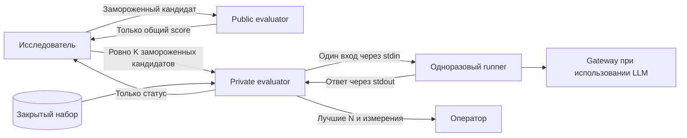

# Граница закрытых данных

Код оценщика открыт. Train доступен исследователю, public скрывает всё кроме общего score кандидата, private скрывает от эволюционного агента все результаты. Данные закрытых разделов, эталоны, ответы, трейсы, отдельные оценки, журналы допуска и операторские полномочия находятся внутри доверенного контура.

| Участник | Доступ |
| --- | --- |
| Исследователь | Train, свои кандидаты и train-трейсы; общий public-score; API отправки private и статус серии |
| Закрытый оценщик | Данные своего раздела, эталоны при необходимости, фиксированная метрика, запуск изолированных кандидатов и журнал допуска |
| Одноразовый runner | Замороженный кандидат, разрешённые материалы, текущий вход; model gateway при использовании LLM |
| Model gateway | Фиксированная внутренняя модель и ключ; без датасета, эталонов, журнала допуска и Docker socket |
| Оператор | Закрытое состояние, диагностика и итоговые private-результаты |

Оценщик не импортирует и не исполняет код кандидата в своём процессе. На один пример создаётся отдельный контейнер; текущий вход передаётся через stdin, результат — через stdout. Runner не получает весь датасет, эталоны или результаты других проверок. Общий `/assets` содержит только материалы, разрешённые всем кандидатам. Закрытые вопросы, эталоны и журналы туда не кладут.

Реализация метрики принадлежит оператору, фиксируется до поиска и не запускается из пакета кандидата. Вычисляемая метрика может работать без модели. Модельный судья использует отдельный контекст той же внутренней модели, что и решатель. Разрешение менять харнес и параметры в промпте не расширяет права кандидата и не позволяет изменить измеритель.

Сеть `workers` содержит только gateway и одноразовые runner-контейнеры. Оценщик находится в другой сети. Gateway принимает ограниченный запрос к зафиксированной модели; upstream URL и ключ не передаются кандидату. Доверенный журнал gateway учитывает все модельные вызовы и токены каждого запуска. У немодельного кандидата отсутствие вызовов означает нулевой расход, а не отсутствие измерений. Внешнего порта у gateway нет. `internal: true` в Docker не заменяет правила egress и запрет доступа worker-подсетей к сервисам хоста. [Сети Docker Compose](https://docs.docker.com/reference/compose-file/networks/).

Контейнер исследователя не получает Docker socket, закрытые volumes, ключ модели оценщика или операторский env. Контейнеры работают без root, с read-only root filesystem, ограничениями процессов, памяти и CPU. Только доверенный оценщик имеет Docker socket: эти полномочия позволяют управлять хостом независимо от пользователя контейнера. Поэтому API и операторская учётная запись входят в доверенную границу. [Защита Docker daemon](https://docs.docker.com/engine/security/protect-access/).

Чат может управлять исследованием, если инструменты видят только train-workspace и разрешённые API. Чат с операторским SSH, Docker daemon или чтением закрытых каталогов имеет права оператора: контейнеризация от него данные не скроет. Для такого рабочего места сервис размещают под отдельной кластерной учётной записью с ACL, при необходимости на отдельном узле или VM. Обычный SSH shell на закрытый хост исследователю не предоставляется; допустим ограниченный туннель к API.

Public-кандидат тоже исполняется внутри закрытого контура. Скрыть только файл датасета недостаточно, если исследователь может прочитать stdout, логи кандидата или модельные трассы. API возвращает общий score и служебное состояние проверки, без ответов, отдельных оценок, трейсов и ресурсов примеров. Повторные public-проверки сохраняют привязку к неизменяемому кандидату; их ответы не открывают доступ к private.

Весь private-список подаётся одним пакетом и точно соответствует настройке числа финалистов. Идентичная повторная доставка возвращает прежний статус без нового запуска; другой пакет отклоняется. Оценщик сохраняет durable seal для закреплённого датасета: новый токен, имя кандидата или кампании не дают новый допуск. Прерванная серия получает `failed`; её допуск остаётся израсходованным.

Submit/status возвращают исследователю только статус и после завершения серии. Итоговые баллы, ранжирование и выбранные N доступны только оператору в закрытом состоянии. Не копируй их в исследовательский отчёт, общий MLflow или журнал эволюции. Private не используется для доработки кандидатов. Создание нового state-каталога или операторской конфигурации не открывает повторный поиск на прежнем holdout.

Общий MLflow предназначен для train-экспериментов и допустимых public-score. Название experiment само по себе доступ не ограничивает. Закрытые трейсы и private-результаты сохраняются у оценщика; перенос допустим только в отдельное защищённое хранилище с проверенными правами. [MLflow authentication](https://mlflow.org/docs/latest/self-hosting/security/basic-http-auth/).

Схема защищает от чтения данных через выданные исследователю инструменты и обычного недоверенного кандидата. Она не защищает от администратора хоста, уязвимости ядра или скомпрометированного модельного сервера. Сервер модели и его журналы входят в закрытую границу. Контейнерный worker можно заменить VM-песочницей, сохранив тот же протокол.
