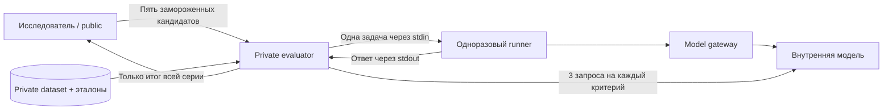

# Граница private

Код оценщика открыт в этом репозитории. Закрыты датасет, эталоны, ответы на private, судейские обоснования, состояние допуска и операторские полномочия.

| Участник | Доступ |
| --- | --- |
| Исследователь | Промпты, public-данные, свои кандидаты, public-трейсы и API отправки финалистов |
| Private evaluator | Private-датасет и эталоны, фиксированная метрика, журнал допуска, внутренний судья, запуск контейнеров |
| Одноразовый runner | Замороженный кандидат, разрешённые общие ресурсы, текущая задача и внутренний model gateway |
| Model gateway | Фиксированная внутренняя модель и ключ; без датасета, эталонов, журнала допуска и Docker socket |

Оценщик не импортирует и не запускает код кандидата в своём процессе. Он создаёт отдельный контейнер на один пример. Runner не получает весь датасет или эталон; запрос передаётся через stdin, ответ забирается через stdout. Приватные ответы и оценки остаются в закрытом состоянии оценщика. Общий `/assets` содержит только разрешённые всем кандидатам материалы: закрытые вопросы, эталоны и журналы туда не кладут.

Сеть `workers` содержит только gateway и одноразовые runner-контейнеры. Оценщик находится в другой сети. Gateway принимает ограниченный запрос к одной модели с фиксированными параметрами; upstream URL и ключ не передаются кандидату. Внешнего порта у gateway нет. Docker `internal: true` ограничивает внешний маршрут, но не заменяет проверку доступа к службам самого хоста и правила egress на кластере. Оператор закрывает worker-подсети доступ к хостовым сервисам и другим сетям. [Сети Docker Compose](https://docs.docker.com/reference/compose-file/networks/).

В стандартном Compose публичный контейнер не получает Docker socket, private volumes, ключ модели оценщика или операторский env. Все контейнеры работают без root, с read-only root filesystem, ограничениями процессов, памяти и CPU. Только доверенный оценщик имеет Docker socket: эти полномочия позволяют управлять хостом, независимо от `user: 10001` и ограничений контейнера. Поэтому его API и операторская учётная запись входят в доверенную границу. [Защита Docker daemon](https://docs.docker.com/engine/security/protect-access/).

Чат может управлять исследованием, если его инструменты видят только public workspace и submit/status API. Чат с SSH оператора, доступом к Docker daemon или чтением приватных каталогов получает те же права, что и оператор: от него контейнеризация данные не скроет. Для такого рабочего места private-сервис размещают под отдельной кластерной учётной записью с ACL, а лучше на отдельном узле или VM. Обычный SSH shell на приватный хост исследователю не предоставляется; возможен только заранее ограниченный туннель к API.

Один токен не даёт создавать новые допуски: оценщик сохраняет durable seal для закреплённого датасета. Все пять финалистов подаются одним batch. Повтор идентичного запроса возвращает прежний статус без нового запуска, изменение batch отклоняется. Прерванная серия получает `failed`; её допуск остаётся закрытым. До завершения всех кандидатов доступны только общие статусы, затем итоговые агрегированные оценки. Private-трейсы, ответы, отдельные вопросы и промежуточные баллы наружу не возвращаются. Создание нового state-каталога или новая операторская конфигурация после раскрытия результата не должны превращаться в повторную оптимизацию на том же holdout.

MLflow `http://gpu6:5050` предназначен здесь для public-экспериментов и разрешённых финальных агрегатов. Название experiment не ограничивает доступ. Private-трейсы остаются локально у оценщика; их перенос допустим лишь в отдельно защищённое хранилище с проверенными правами. [MLflow authentication](https://mlflow.org/docs/latest/self-hosting/security/basic-http-auth/).

Эта схема защищает от чтения данных через выданные исследователю инструменты и обычный недоверенный кандидат. Она не обещает защиту от администратора хоста, уязвимости ядра или скомпрометированного модельного сервера. Модельный сервер и его журналы входят в приватную границу; researcher не должен читать историю private-вызовов. Для усиленной изоляции можно заменить контейнерный worker VM-песочницей, сохранив тот же протокол.
